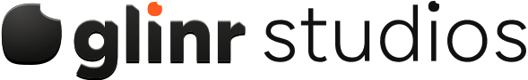

<p align="center">
  <a href="https://thesvg.org">
    <picture>
      <source media="(prefers-color-scheme: dark)" srcset="https://raw.githubusercontent.com/glincker/thesvg/main/public/logo-lockup-dark.svg" />
      <source media="(prefers-color-scheme: light)" srcset="https://raw.githubusercontent.com/glincker/thesvg/main/public/logo-lockup.svg" />
      
    </picture>
  </a>
</p>

<h2 align="center">La biblioteca abierta de marcas en SVG</h2>

<p align="center">Más de 7.900 logos, iconos y banderas en SVG, React, Vue, Svelte, CDN, CLI o MCP. Gratis y de código abierto.</p>

<p align="center">
  <a href="https://trendshift.io/repositories/24396?utm_source=trendshift-badge&utm_medium=badge&utm_campaign=badge-trendshift-24396" target="_blank" rel="noopener noreferrer"></a>
</p>

<p align="center"><sub><a href="https://thesvg.org"><b>Explorar iconos</b></a> · <a href="https://thesvg.org/docs">Docs</a> · <a href="https://thesvg.org/collection/flags">Banderas</a> · <a href="https://thesvg.org/blog/country-flags">Nuevo: banderas</a> · <a href="#inicio-rápido">Inicio rápido</a> · <a href="#instalación">Instalar</a> · <a href="#extensiones">Extensiones</a> · <a href="#cdn">CDN</a> · <a href="#api">API</a> · <a href="#paquetes">Paquetes</a> · <a href="https://thesvg.org/compare">Comparar</a> · <a href="#comunidad">Comunidad</a> · <a href="#contribuir">Contribuir</a></sub></p>

<p align="center"><sub><a href="README.md">English</a> · <b>Español</b> · <a href="README.fr.md">Français</a> · <a href="README.de.md">Deutsch</a> · <a href="README.pt-BR.md">Português</a> · <a href="README.ja.md">日本語</a> · <a href="README.ko.md">한국어</a> · <a href="README.zh-CN.md">简体中文</a> · <a href="README.ru.md">Русский</a> · <a href="README.tr.md">Türkçe</a> · <a href="README.hi.md">हिन्दी</a></sub></p>

<p align="center">
  <a href="https://www.npmjs.com/package/thesvg"></a>
  <a href="https://www.npmjs.com/package/thesvg"></a>
  <a href="https://github.com/glincker/thesvg/stargazers"></a>
  <a href="https://discord.gg/Ar5pcaZB99"></a>
  <a href="https://github.com/glincker/thesvg"></a>
  <a href="https://github.com/glincker/thesvg/blob/main/LICENSE"></a>
</p>


<p align="center">
  <a href="https://thesvg.org">
    <picture>
      <source media="(prefers-color-scheme: dark)" srcset="https://raw.githubusercontent.com/glincker/thesvg/main/public/og-image.png" />
      <source media="(prefers-color-scheme: light)" srcset="https://raw.githubusercontent.com/glincker/thesvg/main/public/og-image-light.png" />
      
    </picture>
  </a>
</p>

<!-- badges:start -->
<p align="center">
  <a href="https://www.npmjs.com/package/@thesvg/flags"></a>
  <a href="https://www.npmjs.com/package/@thesvg/mcp-server"></a>
  <a href="https://www.jsdelivr.com/package/gh/glincker/thesvg"></a>
  <a href="https://www.figma.com/community/plugin/1612997159050367763"></a>
  <a href="https://marketplace.visualstudio.com/items?itemName=glincker.thesvg"></a>
  <a href="https://www.raycast.com/thegdsks/thesvg"></a>
  <a href="https://icon-sets.iconify.design/thesvg-color/"></a>
  <a href="https://github.com/glincker/thesvg/tree/main/extensions/neovim"></a>
  <a href="https://github.com/glincker/thesvg/tree/main/extensions/alfred"></a>
  <a href="https://github.com/glincker/thesvg/tree/main/extensions/browser"></a>
  <a href="https://skills.sh/glincker/thesvg"></a>
  <a href="https://github.com/glincker/homebrew-thesvg"></a>
  <a href="https://socket.dev/npm/package/@thesvg/icons"></a>
  <a href="https://socket.dev/npm/package/thesvg"></a>
  <a href="https://www.npmjs.com/package/@thesvg/icons"></a>
</p>
<!-- badges:end -->

<p align="center">
  <sub>Todos los logotipos de abajo se sirven directamente desde theSVG.</sub>
</p>

<p align="center">
  <a href="https://thesvg.org/icon/google"></a>&nbsp;&nbsp;&nbsp;
  <a href="https://thesvg.org/icon/docker"></a>&nbsp;&nbsp;&nbsp;
  <a href="https://thesvg.org/icon/kubernetes"></a>&nbsp;&nbsp;&nbsp;
  <a href="https://thesvg.org/icon/react"></a>&nbsp;&nbsp;&nbsp;
  <a href="https://thesvg.org/icon/vue"></a>&nbsp;&nbsp;&nbsp;
  <a href="https://thesvg.org/icon/svelte"></a>&nbsp;&nbsp;&nbsp;
  <a href="https://thesvg.org/icon/typescript"></a>&nbsp;&nbsp;&nbsp;
  <a href="https://thesvg.org/icon/tailwindcss"></a>&nbsp;&nbsp;&nbsp;
  <a href="https://thesvg.org/icon/figma"></a>&nbsp;&nbsp;&nbsp;
  <a href="https://thesvg.org/icon/stripe"></a>
</p>

<p align="center">
  <a href="https://thesvg.org/icon/slack"></a>&nbsp;&nbsp;&nbsp;
  <a href="https://thesvg.org/icon/discord"></a>&nbsp;&nbsp;&nbsp;
  <a href="https://thesvg.org/icon/spotify"></a>&nbsp;&nbsp;&nbsp;
  <a href="https://thesvg.org/icon/supabase"></a>&nbsp;&nbsp;&nbsp;
  <a href="https://thesvg.org/icon/postgresql"></a>&nbsp;&nbsp;&nbsp;
  <a href="https://thesvg.org/icon/mongodb"></a>&nbsp;&nbsp;&nbsp;
  <a href="https://thesvg.org/icon/cloudflare"></a>&nbsp;&nbsp;&nbsp;
  <a href="https://thesvg.org/icon/terraform"></a>&nbsp;&nbsp;&nbsp;
  <a href="https://thesvg.org/icon/aws"></a>&nbsp;&nbsp;&nbsp;
  <a href="https://thesvg.org/icon/microsoft-azure"></a>
</p>

<hr />


## Por qué theSVG

Los logotipos de marcas están dispersos entre kits de prensa, archivos de Figma y repositorios de GitHub al azar. **theSVG** es la fuente única de iconos SVG: logotipos de marcas, diagramas de arquitectura en la nube y un conjunto de iconos de interfaz propios. Se pueden buscar, tienen versiones y están disponibles como paquetes npm, CDN, CLI, API y servidor MCP.

Todo desarrollador ha buscado alguna vez el logotipo de una empresa: un kit de prensa enterrado a tres clics, un PNG que se ve borroso en pantallas retina, un archivo "mono" que en realidad tiene cuatro colores, un logotipo que cambió el mes pasado. La mayoría de los conjuntos de iconos cubren glifos de interfaz. Nadie trató los logotipos de marcas como datos reales, con versiones y fiables.

theSVG sí. Es un catálogo abierto donde cada logotipo es **oficial, limpio, completo y actual**, y se entrega en la forma que tu proyecto necesite.

### Por qué lo creamos

theSVG empezó con una pull request. Intentamos añadir el logotipo de nuestro propio producto, [AskVerdict](https://www.askverdict.ai), a una biblioteca de logotipos de código abierto ya existente, y lo rechazaron por quedar fuera del alcance del proyecto, una decisión razonable para un conjunto curado. Eso nos hizo querer un catálogo donde cualquier marca real, grande o pequeña, pueda añadirse mediante una revisión sencilla. theSVG ya reúne más de 7,900 iconos, obtenidos de recursos oficiales de las marcas y revisados antes de cada incorporación.

**UN HOGAR PARA CADA MARCA.**

### El estándar de theSVG

Lo que se exige a cada icono del catálogo, y lo que queremos que signifique un SVG de marca en todas partes:

| Principio | Qué significa en la práctica |
| --- | --- |
| **Oficial, sin modificar** | Tomado del kit o del sitio de la propia marca, con una licencia y un enlace a las directrices en cada entrada. Sin rediseños. |
| **Variantes completas** | `default`, `mono`, `light`, `dark` y `wordmark` bajo un esquema de nombres predecible, para que `{slug}/{variant}.svg` siempre funcione. |
| **Realmente limpio** | Un validador se ejecuta en CI sobre cada archivo modificado: sin scripts, sin imágenes rasterizadas incrustadas, sin valores `null` ni `NaN`, los archivos mono son de verdad de un solo color y `viewBox` siempre está presente. |
| **Los rebrandings conservan el historial** | Cuando una marca cambia su logotipo, la nueva versión pasa a ser la vigente y la anterior se conserva como una entrada `-legacy`, enlazadas en ambos sentidos. Nada desaparece en silencio. |
| **Legible por máquinas** | Un manifiesto estático, `llms.txt`, un servidor MCP y URL de CDN estables, para que herramientas y asistentes de IA usen los logotipos con la misma fiabilidad que las personas. |
| **Abierto a todos** | Código MIT, sin cuentas, sin claves de API, sin filtros. Si una marca es real, tiene su lugar aquí. |

Si esta es la biblioteca de logotipos que siempre quisiste tener, lo más útil que puedes hacer es **[dar una estrella al repositorio](https://github.com/glincker/thesvg)**. Así es como otros desarrolladores lo encuentran.

<table>
  <tr>
    <td align="center" width="25%"><strong><!-- flags:total-icons -->7,900+<!-- /flags:total-icons --></strong><br />iconos</td>
    <td align="center" width="25%"><strong><!-- flags:total-variants -->14,700+<!-- /flags:total-variants --></strong><br />variantes: color, mono, light, dark, wordmark, formas de bandera</td>
    <td align="center" width="25%"><strong>150+</strong><br />categorías</td>
    <td align="center" width="25%"><strong>21</strong><br />familias de marcas</td>
  </tr>
</table>

### Qué contiene

| &nbsp;&nbsp;&nbsp;&nbsp;&nbsp;&nbsp;&nbsp; | Colección | Iconos | Qué incluye |
| --- | --- | --- | --- |
| <picture><source media="(prefers-color-scheme: dark)" srcset="https://cdn.jsdelivr.net/gh/glincker/thesvg@main/public/icons/github/dark.svg" /></picture> | [Iconos de marcas](https://thesvg.org/collection/brands) | 4,800+ | Logotipos de más de 150 categorías en color, mono, light, dark y wordmark |
| <picture><source media="(prefers-color-scheme: dark)" srcset="https://cdn.jsdelivr.net/gh/glincker/thesvg@main/public/icons/1password/dark.svg" /></picture> | [Insignias de autenticación](https://thesvg.org/collection/auth-badges) | 858 | Insignias circulares para 2FA y apps de autenticación |
|  | [Arquitectura de AWS](https://thesvg.org/collection/aws) | 739 | Iconos oficiales de servicios y recursos de AWS |
|  | [Azure](https://thesvg.org/collection/azure) | 626 | Iconos de servicios de Microsoft Azure |
|  | [Comunidad](https://thesvg.org/collection/community) | 256 | Herramientas de desarrollo, bases de datos y frameworks |
|  | [Google Cloud](https://thesvg.org/collection/gcp) | 214 | Iconos de Google Cloud Platform |
|  | [Kubernetes](https://thesvg.org/collection/k8s) | 38 | Iconos oficiales de arquitectura de la CNCF |

<details>
<summary>Colecciones, tabla simple</summary>

theSVG organiza los iconos en colecciones:

| Colección | Iconos | Descripción |
|------------|-------|-------------|
| **Iconos de marcas** | 4,800+ | Logotipos de marcas de más de 150 categorías |
| **Insignias de autenticación** | 858 | Insignias circulares pensadas para apps de 2FA y autenticación |
| **Arquitectura de AWS** | 739 | Iconos oficiales de servicios, recursos, categorías y grupos de AWS (2026-T1) |
| **Servicios de Azure** | 626 | Iconos de servicios de Microsoft Azure (2026-T1) |
| **Comunidad** | 256 | Herramientas de desarrollo, bases de datos y frameworks aportados por la comunidad de código abierto |
| **Google Cloud** | 214 | Iconos de Google Cloud Platform (2026-T1) |
| **Kubernetes** | 38 | Iconos oficiales de arquitectura de Kubernetes/CNCF |
| **Banderas** | <!-- flags:count -->263<!-- /flags:count --> | Banderas de países y regiones en 4x3, cuadrada y circular (categoría `Flags`, slugs `flag-us`, `flag-gb-eng`) |

</details>

### Iconos de interfaz

**Novedad en theSVG 4.0.** Junto al catálogo de marcas, theSVG incluye un conjunto de **iconos de interfaz que dibujamos nosotros**, en [thesvg.org/ui](https://thesvg.org/ui). Hoy son 129 iconos, cada uno en siete estilos (contorno, cristal, duotono, desplazado, relleno, contorno de cristal y profundidad), todos con `currentColor`, y con más novedades en pequeñas entregas. Son una sección aparte, con sus propios datos, paquetes y pruebas, y los dos tipos de iconos nunca mezclan sus datos ni su código. Consulta [Iconos de interfaz](#iconos-de-interfaz-1) más abajo.

### Familias de marcas

Productos agrupados por la empresa que los posee, para que tengas toda la línea de Google, Microsoft, Amazon o Apple en un solo lugar con todas sus variantes. Explora las 21 en [thesvg.org/families](https://thesvg.org/families).

<table>
  <tr>
    <td align="center"><a href="https://thesvg.org/family/google"><br /><b>Google</b></a><br /><sub>100+ logotipos</sub></td>
    <td align="center"><a href="https://thesvg.org/family/microsoft"><br /><b>Microsoft</b></a><br /><sub>70+ logotipos</sub></td>
    <td align="center"><a href="https://thesvg.org/family/adobe"><br /><b>Adobe</b></a><br /><sub>30+ logotipos</sub></td>
    <td align="center"><a href="https://thesvg.org/family/amazon"><br /><b>Amazon</b></a><br /><sub>18 logotipos</sub></td>
    <td align="center"><a href="https://thesvg.org/family/apple"><picture><source media="(prefers-color-scheme: dark)" srcset="https://cdn.jsdelivr.net/gh/glincker/thesvg@main/public/icons/apple/dark.svg" /></picture><br /><b>Apple</b></a><br /><sub>16 logotipos</sub></td>
    <td align="center"><a href="https://thesvg.org/family/jetbrains"><br /><b>JetBrains</b></a><br /><sub>16 logotipos</sub></td>
    <td align="center"><a href="https://thesvg.org/family/ibm"><br /><b>IBM</b></a><br /><sub>14 logotipos</sub></td>
  </tr>
</table>

El desglose completo está en [Colecciones, familias y categorías](./docs/collections.md).

### Lo más destacado

- **<!-- flags:total-icons -->7,900+<!-- /flags:total-icons --> iconos** en varias colecciones
- **4,800+ iconos de marcas** en más de 150 categorías
- **21 familias de marcas**: todos los productos de Amazon, Google, Microsoft y más, agrupados por propietario
- **858 iconos de insignias de autenticación**: insignias circulares para apps de 2FA y autenticación
- **739 iconos de arquitectura de AWS** (2026-T1)
- **626 iconos de servicios de Azure** (2026-T1)
- **256 iconos curados por la comunidad**: herramientas de desarrollo, bases de datos, frameworks
- **214 iconos de Google Cloud** (2026-T1)
- **<!-- flags:count -->263<!-- /flags:count --> banderas de países y regiones**: ISO 3166-1 más Inglaterra, Escocia, Gales, Cataluña y otras, en 4x3, cuadrada y circular
- **<!-- flags:total-variants -->14,700+<!-- /flags:total-variants --> variantes SVG**: color, mono, light, dark, wordmark, formas de bandera
- **Compatible con tree-shaking**: importa un icono y envía solo ese icono
- **TypeScript primero**: totalmente tipado, ESM/CJS dual
- **Independiente del framework**: React, Vue, Svelte, HTML plano o CDN
- **Listo para IA**: servidor MCP para Claude, Cursor y Windsurf

### Banderas

Explóralas en [thesvg.org/collection/flags](https://thesvg.org/collection/flags). Todos los países ISO 3166-1 más Inglaterra, Escocia, Gales, Cataluña, el País Vasco, Galicia, la Comunidad Valenciana, las Islas Baleares, las Islas Canarias, Córcega, Occitania, la UE y la ONU, en tres formas. Los slugs son `flag-<code>` (`flag-us`, `flag-gb-eng`); las variantes son `default` (4x3), `square` y `circle`.

```bash
npm i @thesvg/flags
```

```tsx
import { FlagUs } from "@thesvg/flags/react/us";
import { getFlagForLocale } from "@thesvg/flags/locale";

<FlagUs variant="circle" size={32} />
```

No hace falta instalar nada para usar una imagen simple: `https://cdn.jsdelivr.net/npm/@thesvg/flags/dist/svg/4x3/us.svg` (usa `1x1` o `circle` para las otras formas).

En el sitio, cada bandera tiene su propia página (`/icon/flag-us`) con su paleta de colores, botones de copiar y descargar, una tarjeta de uso (npm, CLI y CDN) y datos indexables. La página de la colección filtra por región, color o idioma, y el buscador del encabezado muestra las banderas en su propia sección para que los iconos de marcas sigan apareciendo primero.

Una bandera es un país, no un idioma: muestra junto a ella el nombre del idioma en su lengua nativa. Guía: [docs/flags.md](./docs/flags.md).

### Iconos de arquitectura de AWS

Explora todos los iconos de servicios y recursos de AWS en [thesvg.org/collection/aws](https://thesvg.org/collection/aws). Los iconos proceden del paquete oficial [AWS Architecture Icons](https://aws.amazon.com/architecture/icons/) y se distribuyen sin modificar bajo [CC BY-ND 2.0](https://creativecommons.org/licenses/by-nd/2.0/). Se actualizan cada trimestre.

### Insignias de autenticación

Explora el conjunto completo en [thesvg.org/collection/auth-badges](https://thesvg.org/collection/auth-badges). Insignias circulares de color plano pensadas para listas de aplicaciones de autenticación y pantallas de 2FA, con un estilo visual distinto al de la colección principal de marcas de arriba. Se distribuyen bajo CC0-1.0 (dominio público).

<details>
<summary>Familias de marcas, tabla completa</summary>

Productos agrupados por la empresa que los posee, cada uno con su propia página: toda la línea de Amazon, Google o Microsoft en un solo lugar, con todas sus variantes.

| Familia | Logotipos | Incluye |
| --- | --- | --- |
| [Google](https://thesvg.org/family/google) | 100+ | Workspace, Gemini, Cloud, Android, Chrome |
| [Microsoft](https://thesvg.org/family/microsoft) | 70+ | GitHub, Azure, Dynamics 365, Fabric, Copilot |
| [Adobe](https://thesvg.org/family/adobe) | 30+ | Photoshop, Illustrator, Creative Cloud |
| [Amazon](https://thesvg.org/family/amazon) | 18 | Prime, Kindle, Music, AWS, Twitch, Ring |
| [Apple](https://thesvg.org/family/apple) | 16 | iOS, macOS, Music, iCloud |
| [JetBrains](https://thesvg.org/family/jetbrains) | 16 | IntelliJ IDEA, PyCharm, WebStorm, Rider |
| [IBM](https://thesvg.org/family/ibm) | 14 | Red Hat, HashiCorp, Terraform, Ansible |

Explora las 21 familias en [thesvg.org/families](https://thesvg.org/families). Los mismos datos están disponibles como JSON en [`/api/families.json`](https://thesvg.org/api/families.json) y en [`llms.txt`](https://thesvg.org/llms.txt).

</details>

## Inicio rápido

```bash
# Add a single icon to your project
npx @thesvg/cli add github

# Or install the package and import only what you use
npm install thesvg
```

```ts
import github from "thesvg/github";

github.svg;      // raw SVG string
github.title;    // "GitHub"
github.hex;      // "181717"
```

```html
<!-- Or use the CDN, no install -->

```

Cada icono tiene su propia página con todas las variantes, formatos de copia y vista previa en vivo, por ejemplo [thesvg.org/icon/github](https://thesvg.org/icon/github). Compatible con tree-shaking, totalmente tipado, ESM y CJS. Más en [Instalación y paquetes](./docs/install.md), [Uso y variantes](./docs/usage.md) y [CDN y API](./docs/cdn-api.md).

## Pensado para diseñadores y desarrolladores

<table>
  <tr>
    <td width="50%" valign="top">
      <h4> Si diseñas</h4>
      <ul>
        <li>Inserta logotipos oficiales en Figma como <b>vectores editables</b> con el <a href="https://www.figma.com/community/plugin/1612997159050367763">plugin de Figma</a>.</li>
        <li>Elige la variante adecuada para el fondo: color, mono, light, dark o wordmark.</li>
        <li>Sin rediseñar ni adivinar colores. Cada marca es la original, con un enlace a sus directrices.</li>
        <li>¿Haces diagramas? Usa los <a href="https://icon-sets.iconify.design/thesvg-color/">conjuntos de Iconify</a> en Mermaid, además de bibliotecas para draw.io y Excalidraw, y los iconos de arquitectura de AWS, Azure y Google Cloud.</li>
      </ul>
    </td>
    <td width="50%" valign="top">
      <h4> Si desarrollas</h4>
      <ul>
        <li>Importa un icono y envía solo ese icono: <code>thesvg/github</code> admite tree-shaking y está totalmente tipado.</li>
        <li>Usa componentes de <a href="https://www.npmjs.com/package/@thesvg/react">React</a>, <a href="https://www.npmjs.com/package/@thesvg/vue">Vue</a> o <a href="https://www.npmjs.com/package/@thesvg/svelte">Svelte</a>, o un simple <code>&lt;img&gt;</code> desde el CDN.</li>
        <li>Añade iconos desde la terminal con la <a href="https://www.npmjs.com/package/@thesvg/cli">CLI</a>, o deja que tu editor con IA los obtenga a través del <a href="https://www.npmjs.com/package/@thesvg/mcp-server">servidor MCP</a>.</li>
        <li>URL estables y un manifiesto JSON estático, para que puedas construir sobre él sin claves ni registros.</li>
      </ul>
    </td>
  </tr>
</table>

## Instalación

**npm**

```bash
npm install thesvg
```

**Homebrew**

```bash
brew tap glincker/thesvg
brew install thesvg
```

```ts
import github from "thesvg/github";

github.svg;        // raw SVG string
github.title;      // "GitHub"
github.hex;        // "181717"
github.variants;   // { default: "<svg...>", mono: "<svg...>" }
```

O usa el paquete con ámbito para aprovechar el tree-shaking:

```bash
npm install @thesvg/icons
```

## Paquetes

Todos los paquetes admiten tree-shaking, están totalmente tipados e incluyen ESM y CJS. Elige el que encaje con tu stack. Los iconos de marcas y los de interfaz son paquetes distintos (`@thesvg/ui*`), así que añadir uno nunca hace más pesado al otro.

| &nbsp;&nbsp;&nbsp;&nbsp;&nbsp;&nbsp;&nbsp; | Paquete | Versión | Descargas | Qué es | Instalación |
| --- | --- | --- | --- | --- | --- |
|  | [`thesvg`](https://www.npmjs.com/package/thesvg) | [](https://www.npmjs.com/package/thesvg) | [](https://www.npmjs.com/package/thesvg) | Todos los iconos en un solo paquete | `npm install thesvg` |
|  | [`@thesvg/icons`](https://www.npmjs.com/package/@thesvg/icons) | [](https://www.npmjs.com/package/@thesvg/icons) | [](https://www.npmjs.com/package/@thesvg/icons) | Datos base de iconos, con tree-shaking | `npm install @thesvg/icons` |
|  | [`@thesvg/react`](https://www.npmjs.com/package/@thesvg/react) | [](https://www.npmjs.com/package/@thesvg/react) | [](https://www.npmjs.com/package/@thesvg/react) | Componentes de React tipados | `npm install @thesvg/react` |
|  | [`@thesvg/vue`](https://www.npmjs.com/package/@thesvg/vue) | [](https://www.npmjs.com/package/@thesvg/vue) | [](https://www.npmjs.com/package/@thesvg/vue) | Componentes de Vue 3 tipados | `npm install @thesvg/vue` |
|  | [`@thesvg/svelte`](https://www.npmjs.com/package/@thesvg/svelte) | [](https://www.npmjs.com/package/@thesvg/svelte) | [](https://www.npmjs.com/package/@thesvg/svelte) | Componentes de Svelte tipados | `npm install @thesvg/svelte` |
|  | [`@thesvg/react-native`](https://www.npmjs.com/package/@thesvg/react-native) | [](https://www.npmjs.com/package/@thesvg/react-native) | [](https://www.npmjs.com/package/@thesvg/react-native) | Componentes de React Native | `npm install @thesvg/react-native` |
|  | [`@thesvg/ui`](https://www.npmjs.com/package/@thesvg/ui) | [](https://www.npmjs.com/package/@thesvg/ui) | [](https://www.npmjs.com/package/@thesvg/ui) | Iconos de interfaz: archivos SVG sin procesar y manifiesto JSON | `npm install @thesvg/ui` |
|  | [`@thesvg/ui-react`](https://www.npmjs.com/package/@thesvg/ui-react) | [](https://www.npmjs.com/package/@thesvg/ui-react) | [](https://www.npmjs.com/package/@thesvg/ui-react) | Iconos de interfaz como componentes de React tipados | `npm install @thesvg/ui-react` |
|  | [`@thesvg/ui-vue`](https://www.npmjs.com/package/@thesvg/ui-vue) | [](https://www.npmjs.com/package/@thesvg/ui-vue) | [](https://www.npmjs.com/package/@thesvg/ui-vue) | Iconos de interfaz como componentes de Vue 3 | `npm install @thesvg/ui-vue` |
|  | [`@thesvg/ui-svelte`](https://www.npmjs.com/package/@thesvg/ui-svelte) | [](https://www.npmjs.com/package/@thesvg/ui-svelte) | [](https://www.npmjs.com/package/@thesvg/ui-svelte) | Iconos de interfaz como componentes de Svelte | `npm install @thesvg/ui-svelte` |
|  | [`@thesvg/ui-react-native`](https://www.npmjs.com/package/@thesvg/ui-react-native) | [](https://www.npmjs.com/package/@thesvg/ui-react-native) | [](https://www.npmjs.com/package/@thesvg/ui-react-native) | Iconos de interfaz para React Native | `npm install @thesvg/ui-react-native` |
|  | [`@thesvg/cli`](https://www.npmjs.com/package/@thesvg/cli) | [](https://www.npmjs.com/package/@thesvg/cli) | [](https://www.npmjs.com/package/@thesvg/cli) | Herramienta CLI, instalador al estilo shadcn | `npx @thesvg/cli add github` |
|  | [`@thesvg/mcp-server`](https://www.npmjs.com/package/@thesvg/mcp-server) | [](https://www.npmjs.com/package/@thesvg/mcp-server) | [](https://www.npmjs.com/package/@thesvg/mcp-server) | Servidor MCP para asistentes de IA | `npx @thesvg/mcp-server` |

## Extensiones

Usa los iconos de theSVG en todo lo que construyes, diseñas y publicas. Explora todo el ecosistema en [thesvg.org/extensions](https://thesvg.org/extensions).

| &nbsp;&nbsp;&nbsp;&nbsp;&nbsp;&nbsp;&nbsp; | Extensión | Estado | Qué hace |
| --- | --- | --- | --- |
|  | [Figma Plugin](https://www.figma.com/community/plugin/1612997159050367763) |  | Explora más de 7,600 SVG de marcas, selector de variantes, fila de recientes y atajos de teclado. Inserta como vectores editables. |
|  | [VS Code](https://marketplace.visualstudio.com/items?itemName=glincker.thesvg) |  | Busca más de 7,600 iconos desde la paleta de comandos. Copia SVG, JSX o el enlace del CDN, o insértalo en el cursor. |
|  | [Raycast](https://www.raycast.com/thegdsks/thesvg) |  | Busca, previsualiza y copia cualquier SVG de marca con una sola tecla. Filtra por categoría y previsualiza las variantes. |
|  | [MCP Server](https://www.npmjs.com/package/@thesvg/mcp-server) |  | Llamadas de herramientas de IA para Claude, Cursor y Windsurf. Obtén iconos por nombre o categoría. |
|  | [Agent Skill](https://skills.sh/glincker/thesvg) |  | Skill listo para usar con agentes de IA. Instálalo con `npx skills add glincker/thesvg`. Enseña el CDN y el registro de iconos. |
|  | [`@thesvg/cli`](https://www.npmjs.com/package/@thesvg/cli) |  | Instalador al estilo shadcn. `npx @thesvg/cli add github` añade el SVG a tu proyecto. |
|  | [Homebrew](https://github.com/glincker/homebrew-thesvg) |  | `brew tap glincker/thesvg && brew install thesvg` |
|  | [CDN via jsDelivr](https://www.jsdelivr.com/package/gh/glincker/thesvg) |  | Sirve cualquier icono desde un CDN global. Úsalo en HTML, CSS, Markdown, Notion, Webflow o Framer. |
|  | [Iconify](https://icon-sets.iconify.design/thesvg-color/) |  | Iconos de marcas disponibles como los conjuntos [`thesvg`](https://icon-sets.iconify.design/thesvg/) (mono) y [`thesvg-color`](https://icon-sets.iconify.design/thesvg-color/). Funciona con cualquier herramienta que use Iconify: diagramas de arquitectura de Mermaid, los plugins de Iconify para VS Code y Figma, `@iconify/react` y más. |
|  | [Browser Extension](https://github.com/glincker/thesvg/tree/main/extensions/browser) |  | Ventana emergente para Chrome, Firefox y Edge con más de 7,600 SVG de marcas. MV3, sin telemetría. |
|  | [JetBrains](https://github.com/glincker/thesvg/issues?q=label%3Aextension) |  | Ventana de herramientas para IntelliJ, WebStorm, PyCharm y Rider. Se busca ayuda. |
|  | [Neovim](https://github.com/glincker/thesvg/tree/main/extensions/neovim) |  | Plugin de Lua con selector de Telescope. Inserta la URL del SVG o su contenido en línea en el cursor. |
|  | [Alfred Workflow](https://github.com/glincker/thesvg/tree/main/extensions/alfred) |  | Acceso rápido en macOS. Busca desde cualquier lugar y copia el SVG, la URL del CDN o markdown. |
| <picture><source media="(prefers-color-scheme: dark)" srcset="https://cdn.jsdelivr.net/gh/glincker/thesvg@main/public/icons/sketch/dark.svg" /></picture> | [Sketch / Blender / Webflow / Notion](https://github.com/glincker/thesvg/issues?q=label%3Aextension) |  | Hay incidencias de seguimiento abiertas. Crea un plugin y lo listaremos aquí. |

> **Iconos de interfaz en las extensiones:** la CLI, el servidor MCP, VS Code, la extensión del navegador, Alfred y Neovim buscan tanto iconos de interfaz como de marcas. Figma y Raycast se sumarán tras el lanzamiento. Cada extensión lee los iconos de interfaz de su propio archivo, así que la búsqueda de marcas nunca se ve afectada.

> **Crea la tuya:** la API y el CDN son totalmente abiertos y no requieren autenticación. Publica un plugin o un flujo de trabajo, abre una PR y lo añadiremos a la tabla.

## Uso

<details>
<summary>Ejemplos con React, Vue, Svelte, CDN y CLI</summary>

### React

```tsx
import { Github, Figma } from "@thesvg/react";

export function Logos() {
  return <Github width={24} height={24} className="text-white" />;
}
```

### Vue

```vue
<script setup>
import { Github, Figma } from "@thesvg/vue";
</script>

<template>
  <Github width="24" height="24" />
</template>
```

### Svelte

```svelte
<script>
  import { Github, Figma } from "@thesvg/svelte";
</script>

<Github width="24" height="24" />
```

### CDN

```html

```

### CLI

```bash
npx @thesvg/cli add github
npx @thesvg/cli search "ai"
```

</details>

## Variantes

Los iconos admiten hasta 7 variantes para adaptarse a cualquier contexto de diseño:

| Variante | Clave | Descripción |
|---------|-----|-------------|
| Default | `default` | Color principal de la marca |
| Mono | `mono` | Hereda el color del texto |
| Light | `light` | Relleno oscuro, para fondos claros |
| Dark | `dark` | Relleno claro, para fondos oscuros |
| Wordmark | `wordmark` | Logotipo de texto completo |
| Wordmark Light | `wordmarkLight` | Logotipo de texto en blanco |
| Wordmark Dark | `wordmarkDark` | Logotipo de texto en oscuro |

No todos los iconos tienen todas las variantes. `default` siempre está presente.

## Iconos de interfaz

Iconos de interfaz que dibujamos nosotros, en siete estilos. Explóralos en [thesvg.org/ui](https://thesvg.org/ui).

```bash
npm install @thesvg/ui-react
```

```tsx
import { BellIcon, BellGlassIcon } from "@thesvg/ui-react";

// Outline is the plain name, every other look adds its name.
<BellIcon size={24} aria-label="Notifications" />
<BellGlassIcon size={32} />
```

Una exportación por estilo significa que un estilo que no importas nunca llega a tu bundle. Los paquetes de Vue, Svelte y React Native siguen la misma nomenclatura (`@thesvg/ui-vue`, `@thesvg/ui-svelte`, `@thesvg/ui-react-native`).

| Qué | Dónde |
|------|-------|
| Un archivo de icono | `https://thesvg.org/ui/{slug}/{look}.svg` |
| Todos los iconos de un estilo | `https://cdn.jsdelivr.net/gh/glincker/thesvg@main/src/data/ui/looks/{look}.json` |
| Manifiesto (slugs, etiquetas, categorías, calidad) | `https://cdn.jsdelivr.net/gh/glincker/thesvg@main/src/data/ui-icons.json` |
| CLI | `npx @thesvg/cli add ui:bell --look glass` |

Estilos: `outline`, `glass`, `duotone`, `offset`, `fill`, `glass-outline`, `depth`. Los iconos de interfaz son dibujos originales publicados bajo la [licencia MIT](./LICENSE), igual que el resto del código. Para añadir o modificar iconos, consulta [Contribuir a los iconos de interfaz](./CONTRIBUTING.md#ui-icons).

## CDN

Usa cualquier icono directamente sin instalar nada:

```html
<!-- From thesvg.org -->


<!-- From jsDelivr -->

```

**Patrón de URL:** `https://thesvg.org/icons/{slug}/{variant}.svg`

## API

<details>
<summary>Manifiesto estático, réplicas y ejemplos</summary>

thesvg se publica como un sitio totalmente estático servido desde un CDN. No hay una API dinámica; en su lugar, dos manifiestos JSON precompilados cubren todos los casos de uso. La búsqueda, el filtrado y la paginación ocurren en el cliente.

URL base: `https://thesvg.org`

| Endpoint | Descripción |
|----------|-------------|
| `GET /api/registry.json` | Manifiesto completo de iconos (slug, título, alias, categorías, hex, url, claves de variantes) |
| `GET /api/categories.json` | Lista de categorías con recuentos |
| `GET /icons/{slug}/{variant}.svg` | Archivo SVG sin procesar (p. ej. `/icons/openai/default.svg`) |

```bash
# Fetch the manifest once, filter client-side
curl "https://thesvg.org/api/registry.json" | jq '.icons[] | select(.slug | contains("openai"))'

# Then pull the SVG you want
curl "https://thesvg.org/icons/openai/default.svg"
```

### Réplicas

Para aplicaciones con mucho tráfico, usa jsDelivr (gratis, respaldado por GitHub) en lugar de consultar `thesvg.org` directamente:

```
https://cdn.jsdelivr.net/gh/glincker/thesvg@main/src/data/icons.json
https://cdn.jsdelivr.net/gh/glincker/thesvg@main/public/icons/{slug}/{variant}.svg
```

`src/data/icons.json` es el manifiesto de referencia (los mismos datos con los que se genera `/api/registry.json`, con todos los campos de cada icono, incluidos `license` y `dateAdded`).

También puedes clonar el repositorio (~30 MB) y alojarlo tú mismo. El código está bajo licencia MIT; los iconos de cada marca siguen siendo marcas registradas de sus respectivos propietarios (consulta [LEGAL.md](./LEGAL.md)).

> En la hoja de ruta hay una API con tokens y acceso restringido en `api.thesvg.org` para funciones avanzadas (relevancia de búsqueda, analítica de uso, webhooks). Hasta entonces, el manifiesto estático de arriba es la vía de integración compatible.

</details>

## Categorías

Los iconos están organizados en más de 150 categorías:

`AI` `Analytics` `Identity` `Automotive` `Aviation` `Browser` `Cloud` `CMS` `Community` `Crypto` `Database` `Design` `DevTool` `Education` `Entertainment` `Finance` `Food` `Framework` `Gaming` `Hardware` `Hosting` `IoT` `Language` `Library` `Linux` `Media` `Music` `Payment` `Platform` `Privacy` `Security` `Self-Hosted` `Shopping` `Social` `Software` y más...

## Comunidad

¿Preguntas, solicitudes de iconos o quieres mostrar lo que has creado? Únete al Discord oficial de GLINR, el hogar de theSVG y de todos los demás proyectos de código abierto de GLINR Studios. theSVG tiene allí su propio foro, y las nuevas versiones se publican en él automáticamente.

<a href="https://discord.gg/Ar5pcaZB99"></a>

## Ejecutarlo en local

Necesitas [Node.js](https://nodejs.org) 20 o superior y [pnpm](https://pnpm.io).

```bash
git clone https://github.com/glincker/thesvg.git
cd thesvg
pnpm install
pnpm dev          # http://localhost:3333
```

| Comando | Qué hace |
| --- | --- |
| `pnpm dev` | Inicia el sitio con recarga en caliente en el puerto 3333 |
| `pnpm build` | Regenera la API, `llms.txt`, el feed y los tonos de los iconos, y luego compila el sitio estático |
| `pnpm lint` | Ejecuta ESLint |
| `pnpm test` | Ejecuta la suite de Vitest y las pruebas de la CLI y del paquete de iconos |
| `npx tsx scripts/validate-icons.ts` | Audita cada SVG en busca de scripts, valores incorrectos, archivos mono que no lo son y `viewBox` ausente |

**Añadir un icono:** coloca los archivos en `public/icons/{slug}/` (`default.svg`, más `mono`, `light`, `dark` o `wordmark` según corresponda), registra el slug en `src/data/icons.json`, ejecuta el validador y abre una pull request. Las reglas completas están en [CONTRIBUTING.md](./CONTRIBUTING.md).

## Contribuir

Cada marca merece un lugar. Sin filtros ni guardianes.

**Enviar un icono:** [thesvg.org/submit](https://thesvg.org/submit) o abre una [pull request](https://github.com/glincker/thesvg/pulls).

**Configuración de desarrollo:**

```bash
git clone https://github.com/glincker/thesvg.git
cd thesvg
pnpm install
pnpm dev     # http://localhost:3333
```

Los **iconos de interfaz** tienen su propio flujo: edita un archivo de conjunto en `src/data/ui/sets`, ejecuta `pnpm ui:build` y prueba con `pnpm test:ui`. El trabajo con marcas sigue en `pnpm test:brand`. Consulta [CONTRIBUTING.md](./CONTRIBUTING.md) para ver todas las pautas.

Las preguntas y solicitudes de iconos son bienvenidas en el [Discord](https://discord.gg/Ar5pcaZB99).

## Colaboradores

<a href="https://github.com/glincker/thesvg/graphs/contributors">
  
</a>

## Sigue las novedades

Cada semana llegan nuevos iconos, rebrandings y versiones. Para no perderte nada:

- **Dale una estrella y sigue** el repositorio. Usa *Watch, Custom, Releases* para enterarte de cada nueva versión.
- **Sigue a [GLINR Studios](https://github.com/glincker)** en GitHub para ver el resto de lo que construimos.
- **Únete al [Discord](https://discord.gg/Ar5pcaZB99)** para pedir iconos y ver las versiones en cuanto salen.
- **Explora [thesvg.org](https://thesvg.org)** para ver lo último que se ha añadido.

## Patrocinio

theSVG funciona gracias al alojamiento, al ancho de banda y al tiempo de los mantenedores. Si el catálogo te ahorra un par de horas al año, [elige un nivel](./SPONSORS.md) y asegura ese valor. Los niveles empiezan en $5/mes y van de Sketch a Canvas.

[Patrocinar en GitHub](https://github.com/sponsors/glincker)

## Apoyo

theSVG funciona gracias al alojamiento, al ancho de banda y al tiempo de los mantenedores. [Patrocina en GitHub](https://github.com/sponsors/glincker) o dale una estrella al repositorio para que otros desarrolladores lo encuentren.

<p align="center">
  <a href="https://github.com/glincker/thesvg"></a>
</p>

<a href="https://star-history.com/#glincker/thesvg&Date">
  <picture>
    <source media="(prefers-color-scheme: dark)" srcset="https://api.star-history.com/svg?repos=glincker/thesvg&type=Date&theme=dark" />
    <source media="(prefers-color-scheme: light)" srcset="https://api.star-history.com/svg?repos=glincker/thesvg&type=Date" />
    
  </picture>
</a>

## Aviso legal

Todos los nombres de marcas, logotipos y marcas registradas son propiedad de sus respectivos dueños. theSVG ofrece estos iconos solo con fines de desarrollo y diseño, amparándose en el uso nominativo legítimo. El uso de los recursos de una marca debe respetar las directrices de uso de cada marca.

Los AWS Architecture Icons se proporcionan bajo [CC BY-ND 2.0](https://creativecommons.org/licenses/by-nd/2.0/) (Sin Obra Derivada). Amazon Web Services y todas las marcas relacionadas son marcas registradas de Amazon.com, Inc.

Si eres titular de una marca y quieres que se actualice o se retire un icono, [abre una incidencia](https://github.com/glincker/thesvg/issues) o escribe a **support@glinr.com**. Consulta nuestro [Aviso legal](https://thesvg.org/legal), [TRADEMARK.md](./TRADEMARK.md) y [LEGAL.md](./LEGAL.md) para más detalles.

## Licencia

[MIT](./LICENSE) para el código, las herramientas y los iconos de interfaz. Los iconos de cada marca siguen siendo propiedad intelectual de sus respectivos titulares de marca.

---

<!-- footer-tagline:start -->
<p align="center"><b>La biblioteca abierta de marcas en SVG</b><br />Los logos pertenecen a sus propietarios. theSVG es el catálogo único con los iconos que de verdad se usan, de los más populares a los de uso diario, para que no tengas que buscar en otros sitios. Sigue creciendo.</p>
<!-- footer-tagline:end -->

<p align="center">
  <a href="https://thesvg.org">thesvg.org</a> &nbsp;&bull;&nbsp;
  <a href="./docs/install.md">Instalación</a> &nbsp;&bull;&nbsp;
  <a href="./docs/extensions.md">Extensiones</a> &nbsp;&bull;&nbsp;
  <a href="https://github.com/glincker/thesvg/issues">Incidencias</a>
</p>

<p align="center"><sub>Creado por GLINR Studios. Más del equipo:</sub></p>

<table align="center">
  <tr>
    <td align="center" width="33%">
      <a href="https://glinr.com"><picture><source media="(prefers-color-scheme: dark)" srcset="https://raw.githubusercontent.com/glincker/thesvg/main/public/icons/glinr/wordmark-dark.svg" /></picture></a><br />
      <sub>Código abierto del equipo detrás de theSVG</sub>
    </td>
    <td align="center" width="33%">
      <a href="https://levelrail.com"><br /><b>Levelrail</b></a><br />
      <sub>Alternativa autoalojada a Vercel y Coolify. Git push, HTTPS, registros, rollback.</sub>
    </td>
    <td align="center" width="33%">
      <a href="https://theauth.dev"><br /><b>theAuth</b></a><br />
      <sub>Autenticación para agentes de IA y personas. Identidad de agentes, MCP OAuth 2.1, auditoría.</sub>
    </td>
  </tr>
</table>
