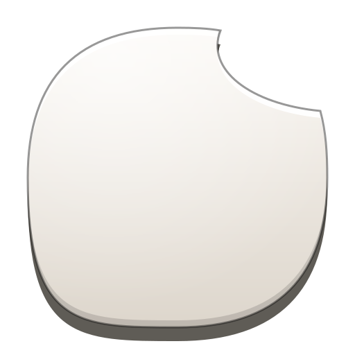

<p align="center">
  <a href="https://thesvg.org">
    <picture>
      <source media="(prefers-color-scheme: dark)" srcset="https://raw.githubusercontent.com/glincker/thesvg/main/public/logo-wordmark-dark.svg" />
      <source media="(prefers-color-scheme: light)" srcset="https://raw.githubusercontent.com/glincker/thesvg/main/public/logo-wordmark.svg" />
      
    </picture>
  </a>
</p>

<h2 align="center">La bibliothèque ouverte de logos de marques en SVG</h2>

<p align="center">Plus de 7 900 logos, icônes et drapeaux en SVG, React, Vue, Svelte, CDN, CLI ou MCP. Gratuit et open source.</p>

<p align="center">
  <a href="https://trendshift.io/repositories/24396?utm_source=trendshift-badge&utm_medium=badge&utm_campaign=badge-trendshift-24396" target="_blank" rel="noopener noreferrer"></a>
</p>

<p align="center"><sub><a href="https://thesvg.org"><b>Parcourir les icônes</b></a> · <a href="https://thesvg.org/docs">Docs</a> · <a href="https://thesvg.org/collection/flags">Drapeaux</a> · <a href="https://thesvg.org/blog/country-flags">Nouveau : drapeaux</a> · <a href="#démarrage-rapide">Démarrage rapide</a> · <a href="#installation">Installer</a> · <a href="#extensions">Extensions</a> · <a href="#cdn">CDN</a> · <a href="#api">API</a> · <a href="#paquets">Paquets</a> · <a href="https://thesvg.org/compare">Comparer</a> · <a href="#communauté">Communauté</a> · <a href="#contribuer">Contribuer</a></sub></p>

<p align="center"><sub><a href="README.md">English</a> · <a href="README.es.md">Español</a> · <b>Français</b> · <a href="README.de.md">Deutsch</a> · <a href="README.pt-BR.md">Português</a> · <a href="README.ja.md">日本語</a> · <a href="README.ko.md">한국어</a> · <a href="README.zh-CN.md">简体中文</a> · <a href="README.ru.md">Русский</a> · <a href="README.tr.md">Türkçe</a> · <a href="README.hi.md">हिन्दी</a></sub></p>

<p align="center">
  <a href="https://www.npmjs.com/package/thesvg"></a>
  <a href="https://www.npmjs.com/package/thesvg"></a>
  <a href="https://github.com/glincker/thesvg/stargazers"></a>
  <a href="https://discord.gg/Ar5pcaZB99"></a>
  <a href="https://github.com/glincker/thesvg"></a>
  <a href="https://github.com/glincker/thesvg/blob/main/LICENSE"></a>
</p>


<p align="center">
  <a href="https://thesvg.org">
    <picture>
      <source media="(prefers-color-scheme: dark)" srcset="https://raw.githubusercontent.com/glincker/thesvg/main/public/og-image.png" />
      <source media="(prefers-color-scheme: light)" srcset="https://raw.githubusercontent.com/glincker/thesvg/main/public/og-image-light.png" />
      
    </picture>
  </a>
</p>

<!-- badges:start -->
<p align="center">
  <a href="https://www.npmjs.com/package/@thesvg/flags"></a>
  <a href="https://www.npmjs.com/package/@thesvg/mcp-server"></a>
  <a href="https://www.jsdelivr.com/package/gh/glincker/thesvg"></a>
  <a href="https://www.figma.com/community/plugin/1612997159050367763"></a>
  <a href="https://marketplace.visualstudio.com/items?itemName=glincker.thesvg"></a>
  <a href="https://www.raycast.com/thegdsks/thesvg"></a>
  <a href="https://icon-sets.iconify.design/thesvg-color/"></a>
  <a href="https://github.com/glincker/thesvg/tree/main/extensions/neovim"></a>
  <a href="https://github.com/glincker/thesvg/tree/main/extensions/alfred"></a>
  <a href="https://github.com/glincker/thesvg/tree/main/extensions/browser"></a>
  <a href="https://skills.sh/glincker/thesvg"></a>
  <a href="https://github.com/glincker/homebrew-thesvg"></a>
  <a href="https://socket.dev/npm/package/@thesvg/icons"></a>
  <a href="https://socket.dev/npm/package/thesvg"></a>
  <a href="https://www.npmjs.com/package/@thesvg/icons"></a>
</p>
<!-- badges:end -->

<p align="center">
  <sub>Chaque logo ci-dessous est servi directement par theSVG.</sub>
</p>

<p align="center">
  <a href="https://thesvg.org/icon/google"></a>&nbsp;&nbsp;&nbsp;
  <a href="https://thesvg.org/icon/docker"></a>&nbsp;&nbsp;&nbsp;
  <a href="https://thesvg.org/icon/kubernetes"></a>&nbsp;&nbsp;&nbsp;
  <a href="https://thesvg.org/icon/react"></a>&nbsp;&nbsp;&nbsp;
  <a href="https://thesvg.org/icon/vue"></a>&nbsp;&nbsp;&nbsp;
  <a href="https://thesvg.org/icon/svelte"></a>&nbsp;&nbsp;&nbsp;
  <a href="https://thesvg.org/icon/typescript"></a>&nbsp;&nbsp;&nbsp;
  <a href="https://thesvg.org/icon/tailwindcss"></a>&nbsp;&nbsp;&nbsp;
  <a href="https://thesvg.org/icon/figma"></a>&nbsp;&nbsp;&nbsp;
  <a href="https://thesvg.org/icon/stripe"></a>
</p>

<p align="center">
  <a href="https://thesvg.org/icon/slack"></a>&nbsp;&nbsp;&nbsp;
  <a href="https://thesvg.org/icon/discord"></a>&nbsp;&nbsp;&nbsp;
  <a href="https://thesvg.org/icon/spotify"></a>&nbsp;&nbsp;&nbsp;
  <a href="https://thesvg.org/icon/supabase"></a>&nbsp;&nbsp;&nbsp;
  <a href="https://thesvg.org/icon/postgresql"></a>&nbsp;&nbsp;&nbsp;
  <a href="https://thesvg.org/icon/mongodb"></a>&nbsp;&nbsp;&nbsp;
  <a href="https://thesvg.org/icon/cloudflare"></a>&nbsp;&nbsp;&nbsp;
  <a href="https://thesvg.org/icon/terraform"></a>&nbsp;&nbsp;&nbsp;
  <a href="https://thesvg.org/icon/aws"></a>&nbsp;&nbsp;&nbsp;
  <a href="https://thesvg.org/icon/microsoft-azure"></a>
</p>

<hr />


## Pourquoi theSVG

Les logos de marques sont éparpillés entre des kits presse, des fichiers Figma et des dépôts GitHub au hasard. **theSVG** est la source unique d'icônes SVG : logos de marques, schémas d'architecture cloud et un jeu d'icônes d'interface que nous dessinons nous-mêmes. Consultables, versionnées, et disponibles en paquets npm, CDN, CLI, API et serveur MCP.

Tout développeur a déjà cherché le logo d'une entreprise : un kit presse enfoui à trois clics, un PNG flou sur écran Retina, un fichier « mono » qui contient en réalité quatre couleurs, un logo qui a changé le mois dernier. La plupart des jeux d'icônes couvrent les pictogrammes d'interface. Personne n'avait traité les logos de marques comme des données fiables, versionnées et dignes de confiance.

theSVG le fait. C'est un catalogue ouvert où chaque logo est **officiel, propre, complet et à jour**, livré sous la forme dont votre projet a besoin.

### Pourquoi nous l'avons créé

theSVG est né d'une pull request. Nous avons voulu ajouter le logo de notre propre produit, [AskVerdict](https://www.askverdict.ai), à une bibliothèque de logos open source existante, et il a été refusé car hors du périmètre du projet, ce qui se comprend pour un ensemble sélectionné. Cela nous a donné envie d'un catalogue où n'importe quelle marque réelle, grande ou petite, peut être ajoutée après une simple relecture. theSVG compte aujourd'hui plus de 7,900 icônes, issues des ressources officielles des marques et vérifiées avant chaque fusion.

**UNE PLACE POUR CHAQUE MARQUE.**

### Le standard theSVG

Ce à quoi chaque icône du catalogue est tenue, et ce que nous voulons que signifie un SVG de marque partout :

| Principe | Ce que cela veut dire concrètement |
| --- | --- |
| **Officiel, non modifié** | Pris dans le kit ou sur le site de la marque, avec une licence et un lien vers les consignes sur chaque entrée. Aucun redessin. |
| **Variantes complètes** | `default`, `mono`, `light`, `dark` et `wordmark` selon un schéma de nommage prévisible, pour que `{slug}/{variant}.svg` fonctionne toujours. |
| **Vraiment propre** | Un validateur tourne en CI sur chaque fichier modifié : pas de scripts, pas d'images matricielles intégrées, pas de valeurs `null` ou `NaN`, les fichiers mono n'ont vraiment qu'une couleur, `viewBox` est toujours présent. |
| **Les rebrandings gardent l'historique** | Quand une marque change de logo, le nouveau devient la version courante et l'ancien est conservé comme entrée `-legacy`, liée dans les deux sens. Rien ne disparaît en silence. |
| **Lisible par les machines** | Un manifeste statique, `llms.txt`, un serveur MCP et des URL de CDN stables, pour que les outils et les assistants IA utilisent les logos aussi fiablement que les humains. |
| **Ouvert à tous** | Code MIT, sans compte, sans clé d'API, sans filtre. Si une marque existe, elle a sa place ici. |

Si c'est la bibliothèque de logos dont vous rêviez, le geste le plus utile est de **[mettre une étoile au dépôt](https://github.com/glincker/thesvg)**. C'est ainsi que d'autres développeurs le découvrent.

<table>
  <tr>
    <td align="center" width="25%"><strong><!-- flags:total-icons -->7,900+<!-- /flags:total-icons --></strong><br />icônes</td>
    <td align="center" width="25%"><strong><!-- flags:total-variants -->14,700+<!-- /flags:total-variants --></strong><br />variantes : color, mono, light, dark, wordmark, formes de drapeaux</td>
    <td align="center" width="25%"><strong>150+</strong><br />catégories</td>
    <td align="center" width="25%"><strong>21</strong><br />familles de marques</td>
  </tr>
</table>

### Ce qu'il y a dedans

| &nbsp;&nbsp;&nbsp;&nbsp;&nbsp;&nbsp;&nbsp; | Collection | Icônes | Contenu |
| --- | --- | --- | --- |
| <picture><source media="(prefers-color-scheme: dark)" srcset="https://cdn.jsdelivr.net/gh/glincker/thesvg@main/public/icons/github/dark.svg" /></picture> | [Icônes de marques](https://thesvg.org/collection/brands) | 4,800+ | Logos de plus de 150 catégories en color, mono, light, dark et wordmark |
| <picture><source media="(prefers-color-scheme: dark)" srcset="https://cdn.jsdelivr.net/gh/glincker/thesvg@main/public/icons/1password/dark.svg" /></picture> | [Badges d'authentification](https://thesvg.org/collection/auth-badges) | 858 | Badges circulaires pour la 2FA et les applications d'authentification |
|  | [Architecture AWS](https://thesvg.org/collection/aws) | 739 | Icônes officielles des services et ressources AWS |
|  | [Azure](https://thesvg.org/collection/azure) | 626 | Icônes des services Microsoft Azure |
|  | [Community](https://thesvg.org/collection/community) | 256 | Outils de développement, bases de données et frameworks |
|  | [Google Cloud](https://thesvg.org/collection/gcp) | 214 | Icônes de Google Cloud Platform |
|  | [Kubernetes](https://thesvg.org/collection/k8s) | 38 | Icônes d'architecture officielles de la CNCF |

<details>
<summary>Collections, tableau simple</summary>

theSVG organise les icônes en collections :

| Collection | Icônes | Description |
|------------|-------|-------------|
| **Icônes de marques** | 4,800+ | Logos de marques de plus de 150 catégories |
| **Badges d'authentification** | 858 | Badges circulaires conçus pour la 2FA et les applications d'authentification |
| **Architecture AWS** | 739 | Icônes officielles des services, ressources, catégories et groupes AWS (2026-T1) |
| **Services Azure** | 626 | Icônes des services Microsoft Azure (2026-T1) |
| **Community** | 256 | Outils de développement, bases de données et frameworks issus de la communauté open source |
| **Google Cloud** | 214 | Icônes de Google Cloud Platform (2026-T1) |
| **Kubernetes** | 38 | Icônes d'architecture officielles de Kubernetes/CNCF |
| **Drapeaux** | <!-- flags:count -->263<!-- /flags:count --> | Drapeaux de pays et de régions en 4x3, carré et rond (catégorie `Flags`, slugs `flag-us`, `flag-gb-eng`) |

</details>

### Icônes UI

**Nouveau dans theSVG 4.0.** En plus du catalogue de marques, theSVG propose un jeu d'**icônes d'interface que nous dessinons nous-mêmes**, sur [thesvg.org/ui](https://thesvg.org/ui). 129 icônes aujourd'hui, chacune en sept styles (contour, verre, bichromie, décalé, plein, contour verre et profondeur), toutes en `currentColor`, avec d'autres à venir par petites livraisons. C'est une section à part, avec ses propres données, paquets et tests, et les deux types d'icônes ne mélangent jamais leurs données ni leur code. Voir [Icônes UI](#icônes-ui-1) plus bas.

### Familles de marques

Les produits regroupés par entreprise propriétaire, pour retrouver toute la gamme Google, Microsoft, Amazon ou Apple au même endroit, avec toutes les variantes. Parcourez les 21 sur [thesvg.org/families](https://thesvg.org/families).

<table>
  <tr>
    <td align="center"><a href="https://thesvg.org/family/google"><br /><b>Google</b></a><br /><sub>100+ logos</sub></td>
    <td align="center"><a href="https://thesvg.org/family/microsoft"><br /><b>Microsoft</b></a><br /><sub>70+ logos</sub></td>
    <td align="center"><a href="https://thesvg.org/family/adobe"><br /><b>Adobe</b></a><br /><sub>30+ logos</sub></td>
    <td align="center"><a href="https://thesvg.org/family/amazon"><br /><b>Amazon</b></a><br /><sub>18 logos</sub></td>
    <td align="center"><a href="https://thesvg.org/family/apple"><picture><source media="(prefers-color-scheme: dark)" srcset="https://cdn.jsdelivr.net/gh/glincker/thesvg@main/public/icons/apple/dark.svg" /></picture><br /><b>Apple</b></a><br /><sub>16 logos</sub></td>
    <td align="center"><a href="https://thesvg.org/family/jetbrains"><br /><b>JetBrains</b></a><br /><sub>16 logos</sub></td>
    <td align="center"><a href="https://thesvg.org/family/ibm"><br /><b>IBM</b></a><br /><sub>14 logos</sub></td>
  </tr>
</table>

Le détail complet se trouve dans [Collections, familles et catégories](./docs/collections.md).

### Points forts

- **<!-- flags:total-icons -->7,900+<!-- /flags:total-icons --> icônes** réparties en plusieurs collections
- **4,800+ icônes de marques** dans plus de 150 catégories
- **21 familles de marques** : tous les produits d'Amazon, Google, Microsoft et d'autres, regroupés par propriétaire
- **858 badges d'authentification** : badges circulaires pour la 2FA et les applications d'authentification
- **739 icônes d'architecture AWS** (2026-T1)
- **626 icônes de services Azure** (2026-T1)
- **256 icônes sélectionnées par la communauté** : outils de développement, bases de données, frameworks
- **214 icônes Google Cloud** (2026-T1)
- **<!-- flags:count -->263<!-- /flags:count --> drapeaux de pays et de régions** : ISO 3166-1 plus l'Angleterre, l'Écosse, le pays de Galles, la Catalogne et d'autres, en 4x3, carré et rond
- **<!-- flags:total-variants -->14,700+<!-- /flags:total-variants --> variantes SVG** : color, mono, light, dark, wordmark, formes de drapeaux
- **Compatible tree-shaking** : importez une icône, ne livrez que cette icône
- **TypeScript d'abord** : entièrement typé, ESM/CJS
- **Indépendant du framework** : React, Vue, Svelte, HTML pur ou CDN
- **Prêt pour l'IA** : serveur MCP pour Claude, Cursor et Windsurf

### Drapeaux

À parcourir sur [thesvg.org/collection/flags](https://thesvg.org/collection/flags). Tous les pays ISO 3166-1 plus l'Angleterre, l'Écosse, le pays de Galles, la Catalogne, le Pays basque, la Galice, la Communauté valencienne, les îles Baléares, les îles Canaries, la Corse, l'Occitanie, l'UE et l'ONU, en trois formes. Les slugs sont `flag-<code>` (`flag-us`, `flag-gb-eng`) ; les variantes sont `default` (4x3), `square` et `circle`.

```bash
npm i @thesvg/flags
```

```tsx
import { FlagUs } from "@thesvg/flags/react/us";
import { getFlagForLocale } from "@thesvg/flags/locale";

<FlagUs variant="circle" size={32} />
```

Aucune installation n'est nécessaire pour une simple image : `https://cdn.jsdelivr.net/npm/@thesvg/flags/dist/svg/4x3/us.svg` (utilisez `1x1` ou `circle` pour les autres formes).

Sur le site, chaque drapeau a sa propre page (`/icon/flag-us`) avec sa palette de couleurs, des boutons de copie et de téléchargement, une carte d'utilisation (npm, CLI et CDN) et des informations indexables. La page de la collection filtre par région, couleur ou langue, et la recherche de l'en-tête présente les drapeaux dans leur propre section pour que les icônes de marques restent en premier.

Un drapeau représente un pays, pas une langue : affichez à côté le nom de la langue dans sa version native. Guide : [docs/flags.md](./docs/flags.md).

### Icônes d'architecture AWS

Parcourez toutes les icônes de services et de ressources AWS sur [thesvg.org/collection/aws](https://thesvg.org/collection/aws). Les icônes proviennent du paquet officiel [AWS Architecture Icons](https://aws.amazon.com/architecture/icons/) et sont distribuées sans modification sous [CC BY-ND 2.0](https://creativecommons.org/licenses/by-nd/2.0/). Mises à jour chaque trimestre.

### Badges d'authentification

Parcourez l'ensemble complet sur [thesvg.org/collection/auth-badges](https://thesvg.org/collection/auth-badges). Des badges circulaires en aplats de couleur, conçus pour les listes d'applications d'authentification et les interfaces 2FA, dans un style visuel distinct de la collection principale de marques ci-dessus. Distribués sous CC0-1.0 (domaine public).

<details>
<summary>Familles de marques, tableau complet</summary>

Les produits regroupés par entreprise propriétaire, chacun avec sa propre page : toute la gamme Amazon, Google ou Microsoft au même endroit, avec toutes les variantes.

| Famille | Logos | Comprend |
| --- | --- | --- |
| [Google](https://thesvg.org/family/google) | 100+ | Workspace, Gemini, Cloud, Android, Chrome |
| [Microsoft](https://thesvg.org/family/microsoft) | 70+ | GitHub, Azure, Dynamics 365, Fabric, Copilot |
| [Adobe](https://thesvg.org/family/adobe) | 30+ | Photoshop, Illustrator, Creative Cloud |
| [Amazon](https://thesvg.org/family/amazon) | 18 | Prime, Kindle, Music, AWS, Twitch, Ring |
| [Apple](https://thesvg.org/family/apple) | 16 | iOS, macOS, Music, iCloud |
| [JetBrains](https://thesvg.org/family/jetbrains) | 16 | IntelliJ IDEA, PyCharm, WebStorm, Rider |
| [IBM](https://thesvg.org/family/ibm) | 14 | Red Hat, HashiCorp, Terraform, Ansible |

Parcourez les 21 familles sur [thesvg.org/families](https://thesvg.org/families). Les mêmes données sont disponibles en JSON sur [`/api/families.json`](https://thesvg.org/api/families.json) et dans [`llms.txt`](https://thesvg.org/llms.txt).

</details>

## Démarrage rapide

```bash
# Add a single icon to your project
npx @thesvg/cli add github

# Or install the package and import only what you use
npm install thesvg
```

```ts
import github from "thesvg/github";

github.svg;      // raw SVG string
github.title;    // "GitHub"
github.hex;      // "181717"
```

```html
<!-- Or use the CDN, no install -->

```

Chaque icône a sa propre page avec toutes les variantes, les formats de copie et un aperçu en direct, par exemple [thesvg.org/icon/github](https://thesvg.org/icon/github). Compatible tree-shaking, entièrement typé, ESM et CJS. Plus de détails dans [Installation et paquets](./docs/install.md), [Utilisation et variantes](./docs/usage.md) et [CDN et API](./docs/cdn-api.md).

## Pensé pour les designers et les développeurs

<table>
  <tr>
    <td width="50%" valign="top">
      <h4> Si vous concevez</h4>
      <ul>
        <li>Insérez des logos officiels dans Figma sous forme de <b>vecteurs modifiables</b> avec le <a href="https://www.figma.com/community/plugin/1612997159050367763">plugin Figma</a>.</li>
        <li>Choisissez la bonne variante selon le fond : color, mono, light, dark ou wordmark.</li>
        <li>Pas de redessin, pas de recoloration au jugé. Chaque logo est celui de la marque, avec un lien vers ses consignes.</li>
        <li>Des schémas à faire ? Utilisez les <a href="https://icon-sets.iconify.design/thesvg-color/">jeux Iconify</a> dans Mermaid, les bibliothèques draw.io et Excalidraw, ainsi que les icônes d'architecture AWS, Azure et Google Cloud.</li>
      </ul>
    </td>
    <td width="50%" valign="top">
      <h4> Si vous développez</h4>
      <ul>
        <li>Importez une icône, ne livrez que cette icône : <code>thesvg/github</code> est compatible tree-shaking et entièrement typé.</li>
        <li>Utilisez les composants <a href="https://www.npmjs.com/package/@thesvg/react">React</a>, <a href="https://www.npmjs.com/package/@thesvg/vue">Vue</a> ou <a href="https://www.npmjs.com/package/@thesvg/svelte">Svelte</a>, ou une simple balise <code>&lt;img&gt;</code> depuis le CDN.</li>
        <li>Ajoutez des icônes depuis le terminal avec la <a href="https://www.npmjs.com/package/@thesvg/cli">CLI</a>, ou laissez votre éditeur IA les récupérer via le <a href="https://www.npmjs.com/package/@thesvg/mcp-server">serveur MCP</a>.</li>
        <li>Des URL stables et un manifeste JSON statique, pour construire dessus sans clé ni inscription.</li>
      </ul>
    </td>
  </tr>
</table>

## Installation

**npm**

```bash
npm install thesvg
```

**Homebrew**

```bash
brew tap glincker/thesvg
brew install thesvg
```

```ts
import github from "thesvg/github";

github.svg;        // raw SVG string
github.title;      // "GitHub"
github.hex;        // "181717"
github.variants;   // { default: "<svg...>", mono: "<svg...>" }
```

Ou utilisez le paquet à portée (scoped) pour le tree-shaking :

```bash
npm install @thesvg/icons
```

## Paquets

Chaque paquet est compatible tree-shaking, entièrement typé et fournit ESM et CJS. Choisissez celui qui correspond à votre stack. Les icônes de marques et les icônes d'interface sont des paquets distincts (`@thesvg/ui*`), donc ajouter l'un n'alourdit jamais l'autre.

| &nbsp;&nbsp;&nbsp;&nbsp;&nbsp;&nbsp;&nbsp; | Paquet | Version | Téléchargements | Description | Installation |
| --- | --- | --- | --- | --- | --- |
|  | [`thesvg`](https://www.npmjs.com/package/thesvg) | [](https://www.npmjs.com/package/thesvg) | [](https://www.npmjs.com/package/thesvg) | Toutes les icônes dans un seul paquet | `npm install thesvg` |
|  | [`@thesvg/icons`](https://www.npmjs.com/package/@thesvg/icons) | [](https://www.npmjs.com/package/@thesvg/icons) | [](https://www.npmjs.com/package/@thesvg/icons) | Données d'icônes de base, compatible tree-shaking | `npm install @thesvg/icons` |
|  | [`@thesvg/react`](https://www.npmjs.com/package/@thesvg/react) | [](https://www.npmjs.com/package/@thesvg/react) | [](https://www.npmjs.com/package/@thesvg/react) | Composants React typés | `npm install @thesvg/react` |
|  | [`@thesvg/vue`](https://www.npmjs.com/package/@thesvg/vue) | [](https://www.npmjs.com/package/@thesvg/vue) | [](https://www.npmjs.com/package/@thesvg/vue) | Composants Vue 3 typés | `npm install @thesvg/vue` |
|  | [`@thesvg/svelte`](https://www.npmjs.com/package/@thesvg/svelte) | [](https://www.npmjs.com/package/@thesvg/svelte) | [](https://www.npmjs.com/package/@thesvg/svelte) | Composants Svelte typés | `npm install @thesvg/svelte` |
|  | [`@thesvg/react-native`](https://www.npmjs.com/package/@thesvg/react-native) | [](https://www.npmjs.com/package/@thesvg/react-native) | [](https://www.npmjs.com/package/@thesvg/react-native) | Composants React Native | `npm install @thesvg/react-native` |
|  | [`@thesvg/ui`](https://www.npmjs.com/package/@thesvg/ui) | [](https://www.npmjs.com/package/@thesvg/ui) | [](https://www.npmjs.com/package/@thesvg/ui) | Icônes UI : fichiers SVG bruts et manifeste JSON | `npm install @thesvg/ui` |
|  | [`@thesvg/ui-react`](https://www.npmjs.com/package/@thesvg/ui-react) | [](https://www.npmjs.com/package/@thesvg/ui-react) | [](https://www.npmjs.com/package/@thesvg/ui-react) | Icônes UI en composants React typés | `npm install @thesvg/ui-react` |
|  | [`@thesvg/ui-vue`](https://www.npmjs.com/package/@thesvg/ui-vue) | [](https://www.npmjs.com/package/@thesvg/ui-vue) | [](https://www.npmjs.com/package/@thesvg/ui-vue) | Icônes UI en composants Vue 3 | `npm install @thesvg/ui-vue` |
|  | [`@thesvg/ui-svelte`](https://www.npmjs.com/package/@thesvg/ui-svelte) | [](https://www.npmjs.com/package/@thesvg/ui-svelte) | [](https://www.npmjs.com/package/@thesvg/ui-svelte) | Icônes UI en composants Svelte | `npm install @thesvg/ui-svelte` |
|  | [`@thesvg/ui-react-native`](https://www.npmjs.com/package/@thesvg/ui-react-native) | [](https://www.npmjs.com/package/@thesvg/ui-react-native) | [](https://www.npmjs.com/package/@thesvg/ui-react-native) | Icônes UI pour React Native | `npm install @thesvg/ui-react-native` |
|  | [`@thesvg/cli`](https://www.npmjs.com/package/@thesvg/cli) | [](https://www.npmjs.com/package/@thesvg/cli) | [](https://www.npmjs.com/package/@thesvg/cli) | Outil CLI, installateur à la shadcn | `npx @thesvg/cli add github` |
|  | [`@thesvg/mcp-server`](https://www.npmjs.com/package/@thesvg/mcp-server) | [](https://www.npmjs.com/package/@thesvg/mcp-server) | [](https://www.npmjs.com/package/@thesvg/mcp-server) | Serveur MCP pour assistants IA | `npx @thesvg/mcp-server` |

## Extensions

Utilisez les icônes theSVG partout où vous construisez, concevez et livrez. Parcourez tout l'écosystème sur [thesvg.org/extensions](https://thesvg.org/extensions).

| &nbsp;&nbsp;&nbsp;&nbsp;&nbsp;&nbsp;&nbsp; | Extension | Statut | Fonction |
| --- | --- | --- | --- |
|  | [Figma Plugin](https://www.figma.com/community/plugin/1612997159050367763) |  | Parcourez plus de 7,600 SVG de marques, sélecteur de variantes, ligne des récents, raccourcis clavier. Insertion en vecteurs modifiables. |
|  | [VS Code](https://marketplace.visualstudio.com/items?itemName=glincker.thesvg) |  | Recherchez plus de 7,600 icônes depuis la palette de commandes. Copiez le SVG, le JSX ou le lien CDN, ou insérez-le au curseur. |
|  | [Raycast](https://www.raycast.com/thegdsks/thesvg) |  | Recherchez, prévisualisez et copiez n'importe quel SVG de marque en une frappe. Filtrez par catégorie, prévisualisez les variantes. |
|  | [MCP Server](https://www.npmjs.com/package/@thesvg/mcp-server) |  | Appels d'outils IA pour Claude, Cursor, Windsurf. Récupérez des icônes par nom ou par catégorie. |
|  | [Agent Skill](https://skills.sh/glincker/thesvg) |  | Skill prêt à l'emploi pour les agents IA. Installation via `npx skills add glincker/thesvg`. Il enseigne le CDN et le registre d'icônes. |
|  | [`@thesvg/cli`](https://www.npmjs.com/package/@thesvg/cli) |  | Installateur à la shadcn. `npx @thesvg/cli add github` ajoute le SVG à votre projet. |
|  | [Homebrew](https://github.com/glincker/homebrew-thesvg) |  | `brew tap glincker/thesvg && brew install thesvg` |
|  | [CDN via jsDelivr](https://www.jsdelivr.com/package/gh/glincker/thesvg) |  | Servez n'importe quelle icône via un CDN mondial. À intégrer dans HTML, CSS, Markdown, Notion, Webflow, Framer. |
|  | [Iconify](https://icon-sets.iconify.design/thesvg-color/) |  | Icônes de marques disponibles dans les jeux [`thesvg`](https://icon-sets.iconify.design/thesvg/) (mono) et [`thesvg-color`](https://icon-sets.iconify.design/thesvg-color/). Compatible avec tout outil utilisant Iconify : diagrammes d'architecture Mermaid, plugins Iconify pour VS Code et Figma, `@iconify/react` et plus encore. |
|  | [Browser Extension](https://github.com/glincker/thesvg/tree/main/extensions/browser) |  | Popup pour Chrome, Firefox et Edge avec plus de 7,600 SVG de marques. MV3, sans télémétrie. |
|  | [JetBrains](https://github.com/glincker/thesvg/issues?q=label%3Aextension) |  | Fenêtre d'outils pour IntelliJ, WebStorm, PyCharm et Rider. Aide recherchée. |
|  | [Neovim](https://github.com/glincker/thesvg/tree/main/extensions/neovim) |  | Plugin Lua avec sélecteur Telescope. Insère l'URL du SVG ou son contenu en ligne au curseur. |
|  | [Alfred Workflow](https://github.com/glincker/thesvg/tree/main/extensions/alfred) |  | Accès rapide sur macOS. Recherchez depuis n'importe où, copiez le SVG, l'URL du CDN ou du markdown. |
| <picture><source media="(prefers-color-scheme: dark)" srcset="https://cdn.jsdelivr.net/gh/glincker/thesvg@main/public/icons/sketch/dark.svg" /></picture> | [Sketch / Blender / Webflow / Notion](https://github.com/glincker/thesvg/issues?q=label%3Aextension) |  | Tickets de suivi ouverts. Créez un plugin et nous le listerons ici. |

> **Icônes d'interface dans les extensions :** la CLI, le serveur MCP, VS Code, l'extension navigateur, Alfred et Neovim recherchent aussi bien les icônes d'interface que les icônes de marques. Figma et Raycast suivront après le lancement. Chaque extension lit les icônes d'interface dans son propre fichier, donc la recherche de marques n'est jamais affectée.

> **Créez la vôtre :** l'API et le CDN sont entièrement ouverts, sans authentification. Publiez un plugin ou un workflow, puis ouvrez une PR et nous l'ajouterons au tableau.

## Utilisation

<details>
<summary>Exemples React, Vue, Svelte, CDN et CLI</summary>

### React

```tsx
import { Github, Figma } from "@thesvg/react";

export function Logos() {
  return <Github width={24} height={24} className="text-white" />;
}
```

### Vue

```vue
<script setup>
import { Github, Figma } from "@thesvg/vue";
</script>

<template>
  <Github width="24" height="24" />
</template>
```

### Svelte

```svelte
<script>
  import { Github, Figma } from "@thesvg/svelte";
</script>

<Github width="24" height="24" />
```

### CDN

```html

```

### CLI

```bash
npx @thesvg/cli add github
npx @thesvg/cli search "ai"
```

</details>

## Variantes

Les icônes prennent en charge jusqu'à 7 variantes pour s'adapter à tous les contextes de design :

| Variante | Clé | Description |
|---------|-----|-------------|
| Default | `default` | Couleur principale de la marque |
| Mono | `mono` | Hérite de la couleur du texte |
| Light | `light` | Remplissage sombre, pour fonds clairs |
| Dark | `dark` | Remplissage clair, pour fonds sombres |
| Wordmark | `wordmark` | Logo textuel complet |
| Wordmark Light | `wordmarkLight` | Logo textuel blanc |
| Wordmark Dark | `wordmarkDark` | Logo textuel sombre |

Toutes les icônes n'ont pas toutes les variantes. `default` est toujours présente.

## Icônes UI

Des icônes d'interface que nous dessinons nous-mêmes, en sept styles. Parcourez-les sur [thesvg.org/ui](https://thesvg.org/ui).

```bash
npm install @thesvg/ui-react
```

```tsx
import { BellIcon, BellGlassIcon } from "@thesvg/ui-react";

// Outline is the plain name, every other look adds its name.
<BellIcon size={24} aria-label="Notifications" />
<BellGlassIcon size={32} />
```

Un export par style signifie qu'un style que vous n'importez pas n'arrive jamais dans votre bundle. Les paquets Vue, Svelte et React Native suivent la même convention de nommage (`@thesvg/ui-vue`, `@thesvg/ui-svelte`, `@thesvg/ui-react-native`).

| Quoi | Où |
|------|-------|
| Un fichier d'icône | `https://thesvg.org/ui/{slug}/{look}.svg` |
| Toutes les icônes d'un style | `https://cdn.jsdelivr.net/gh/glincker/thesvg@main/src/data/ui/looks/{look}.json` |
| Manifeste (slugs, tags, catégories, qualité) | `https://cdn.jsdelivr.net/gh/glincker/thesvg@main/src/data/ui-icons.json` |
| CLI | `npx @thesvg/cli add ui:bell --look glass` |

Styles : `outline`, `glass`, `duotone`, `offset`, `fill`, `glass-outline`, `depth`. Les icônes d'interface sont des dessins originaux publiés sous [licence MIT](./LICENSE), comme le reste du code. Pour ajouter ou modifier des icônes, voir [Contribuer aux icônes UI](./CONTRIBUTING.md#ui-icons).

## CDN

Utilisez n'importe quelle icône directement, sans rien installer :

```html
<!-- From thesvg.org -->


<!-- From jsDelivr -->

```

**Modèle d'URL :** `https://thesvg.org/icons/{slug}/{variant}.svg`

## API

<details>
<summary>Manifeste statique, miroirs et exemples</summary>

thesvg est un site entièrement statique, servi depuis un CDN. Il n'y a pas d'API dynamique ; à la place, deux manifestes JSON précompilés couvrent tous les cas d'usage. La recherche, le filtrage et la pagination se font côté client.

URL de base : `https://thesvg.org`

| Endpoint | Description |
|----------|-------------|
| `GET /api/registry.json` | Manifeste complet des icônes (slug, titre, alias, catégories, hex, url, clés de variantes) |
| `GET /api/categories.json` | Liste des catégories avec leurs effectifs |
| `GET /icons/{slug}/{variant}.svg` | Fichier SVG brut (p. ex. `/icons/openai/default.svg`) |

```bash
# Fetch the manifest once, filter client-side
curl "https://thesvg.org/api/registry.json" | jq '.icons[] | select(.slug | contains("openai"))'

# Then pull the SVG you want
curl "https://thesvg.org/icons/openai/default.svg"
```

### Miroirs

Pour les applications à fort trafic, utilisez jsDelivr (gratuit, adossé à GitHub) plutôt que d'appeler `thesvg.org` directement :

```
https://cdn.jsdelivr.net/gh/glincker/thesvg@main/src/data/icons.json
https://cdn.jsdelivr.net/gh/glincker/thesvg@main/public/icons/{slug}/{variant}.svg
```

`src/data/icons.json` est le manifeste de référence (les mêmes données que celles qui génèrent `/api/registry.json`, avec tous les champs par icône, dont `license` et `dateAdded`).

Vous pouvez aussi cloner le dépôt (~30 Mo) et l'héberger vous-même. Le code est sous licence MIT ; les icônes de chaque marque restent des marques déposées de leurs propriétaires respectifs (voir [LEGAL.md](./LEGAL.md)).

> Une API à jeton, à accès restreint, est prévue sur `api.thesvg.org` pour les fonctionnalités avancées (pertinence de recherche, analyse d'usage, webhooks). D'ici là, le manifeste statique ci-dessus est la voie d'intégration prise en charge.

</details>

## Catégories

Les icônes sont organisées en plus de 150 catégories :

`AI` `Analytics` `Identity` `Automotive` `Aviation` `Browser` `Cloud` `CMS` `Community` `Crypto` `Database` `Design` `DevTool` `Education` `Entertainment` `Finance` `Food` `Framework` `Gaming` `Hardware` `Hosting` `IoT` `Language` `Library` `Linux` `Media` `Music` `Payment` `Platform` `Privacy` `Security` `Self-Hosted` `Shopping` `Social` `Software` et bien d'autres...

## Communauté

Des questions, des demandes d'icônes, ou envie de montrer ce que vous avez construit ? Rejoignez le Discord officiel de GLINR, la maison de theSVG et de tous les autres projets open source de GLINR Studios. theSVG y a son propre forum, et les nouvelles versions y sont publiées automatiquement.

<a href="https://discord.gg/Ar5pcaZB99"></a>

## Lancer en local

Il vous faut [Node.js](https://nodejs.org) 20 ou plus récent et [pnpm](https://pnpm.io).

```bash
git clone https://github.com/glincker/thesvg.git
cd thesvg
pnpm install
pnpm dev          # http://localhost:3333
```

| Commande | Ce qu'elle fait |
| --- | --- |
| `pnpm dev` | Lance le site avec rechargement à chaud sur le port 3333 |
| `pnpm build` | Régénère l'API, `llms.txt`, le flux et les tons d'icônes, puis construit le site statique |
| `pnpm lint` | Lance ESLint |
| `pnpm test` | Lance la suite Vitest ainsi que les tests de la CLI et du paquet d'icônes |
| `npx tsx scripts/validate-icons.ts` | Audite chaque SVG : scripts, valeurs invalides, fichiers mono qui ne le sont pas, `viewBox` manquant |

**Ajouter une icône :** placez les fichiers dans `public/icons/{slug}/` (`default.svg`, plus `mono`, `light`, `dark` ou `wordmark` selon le cas), enregistrez le slug dans `src/data/icons.json`, lancez le validateur, puis ouvrez une pull request. Les règles complètes sont dans [CONTRIBUTING.md](./CONTRIBUTING.md).

## Contribuer

Chaque marque mérite sa place. Sans filtre ni chasse gardée.

**Soumettre une icône :** [thesvg.org/submit](https://thesvg.org/submit) ou ouvrez une [pull request](https://github.com/glincker/thesvg/pulls).

**Environnement de développement :**

```bash
git clone https://github.com/glincker/thesvg.git
cd thesvg
pnpm install
pnpm dev     # http://localhost:3333
```

Les **icônes UI** ont leur propre flux : modifiez un fichier de jeu dans `src/data/ui/sets`, lancez `pnpm ui:build`, et testez avec `pnpm test:ui`. Le travail sur les marques reste dans `pnpm test:brand`. Voir [CONTRIBUTING.md](./CONTRIBUTING.md) pour toutes les consignes.

Questions et demandes d'icônes sont les bienvenues sur le [Discord](https://discord.gg/Ar5pcaZB99).

## Contributeurs

<a href="https://github.com/glincker/thesvg/graphs/contributors">
  
</a>

## Restez informé

De nouvelles icônes, des rebrandings et des versions arrivent chaque semaine. Pour ne rien rater :

- **Mettez une étoile et suivez** le dépôt. Utilisez *Watch, Custom, Releases* pour être prévenu de chaque nouvelle version.
- **Suivez [GLINR Studios](https://github.com/glincker)** sur GitHub pour le reste de ce que nous construisons.
- **Rejoignez le [Discord](https://discord.gg/Ar5pcaZB99)** pour demander des icônes et voir les versions dès leur sortie.
- **Parcourez [thesvg.org](https://thesvg.org)** pour voir ce qui a été ajouté récemment.

## Parrainage

theSVG repose sur l'hébergement, la bande passante et le temps des mainteneurs. Si le catalogue vous fait gagner quelques heures par an, [choisissez un palier](./SPONSORS.md) et verrouillez cette valeur. Les paliers commencent à 5 $/mois et s'échelonnent de Sketch à Canvas.

[Parrainer sur GitHub](https://github.com/sponsors/glincker)

## Soutien

theSVG repose sur l'hébergement, la bande passante et le temps des mainteneurs. [Parrainez sur GitHub](https://github.com/sponsors/glincker) ou mettez une étoile au dépôt pour que d'autres développeurs le trouvent.

<p align="center">
  <a href="https://github.com/glincker/thesvg"></a>
</p>

<a href="https://star-history.com/#glincker/thesvg&Date">
  <picture>
    <source media="(prefers-color-scheme: dark)" srcset="https://api.star-history.com/svg?repos=glincker/thesvg&type=Date&theme=dark" />
    <source media="(prefers-color-scheme: light)" srcset="https://api.star-history.com/svg?repos=glincker/thesvg&type=Date" />
    
  </picture>
</a>

## Avertissement

Tous les noms de marques, logos et marques déposées appartiennent à leurs propriétaires respectifs. theSVG fournit ces icônes uniquement à des fins de développement et de design, au titre de l'usage nominatif. L'utilisation des ressources d'une marque doit respecter les consignes d'utilisation de chaque marque.

Les AWS Architecture Icons sont fournies sous [CC BY-ND 2.0](https://creativecommons.org/licenses/by-nd/2.0/) (Pas de modification). Amazon Web Services et toutes les marques associées sont des marques déposées d'Amazon.com, Inc.

Si vous êtes propriétaire d'une marque et souhaitez qu'une icône soit mise à jour ou retirée, [ouvrez un ticket](https://github.com/glincker/thesvg/issues) ou écrivez à **support@glinr.com**. Consultez nos [Mentions légales](https://thesvg.org/legal), [TRADEMARK.md](./TRADEMARK.md) et [LEGAL.md](./LEGAL.md) pour tous les détails.

## Licence

[MIT](./LICENSE) pour le code, l'outillage et les icônes UI. Les icônes de chaque marque restent la propriété intellectuelle de leurs titulaires respectifs.

---

<!-- footer-tagline:start -->
<p align="center"><b>La bibliothèque ouverte de logos de marques en SVG</b><br />Les logos appartiennent à leurs propriétaires. theSVG est le catalogue unique des icônes réellement utilisées, des plus populaires aux plus courantes, pour ne plus avoir à chercher ailleurs. Il ne cesse de s'enrichir.</p>
<!-- footer-tagline:end -->

<p align="center">
  <a href="https://thesvg.org">thesvg.org</a> &nbsp;&bull;&nbsp;
  <a href="./docs/install.md">Installation</a> &nbsp;&bull;&nbsp;
  <a href="./docs/extensions.md">Extensions</a> &nbsp;&bull;&nbsp;
  <a href="https://github.com/glincker/thesvg/issues">Tickets</a>
</p>

<p align="center"><sub>Créé par GLINR Studios. Plus de projets de l'équipe :</sub></p>

<table align="center">
  <tr>
    <td align="center" width="33%">
      <a href="https://glinr.com"><picture><source media="(prefers-color-scheme: dark)" srcset="https://raw.githubusercontent.com/glincker/thesvg/main/public/icons/glinr/dark.svg" /></picture><br /><b>GLINR Studios</b></a><br />
      <sub>Open source par l'équipe derrière theSVG</sub>
    </td>
    <td align="center" width="33%">
      <a href="https://levelrail.com"><br /><b>Levelrail</b></a><br />
      <sub>Alternative auto-hébergée à Vercel et Coolify. Git push, HTTPS, journaux, rollback.</sub>
    </td>
    <td align="center" width="33%">
      <a href="https://theauth.dev"><br /><b>theAuth</b></a><br />
      <sub>Authentification pour agents IA et humains. Identité des agents, MCP OAuth 2.1, audit.</sub>
    </td>
  </tr>
</table>
