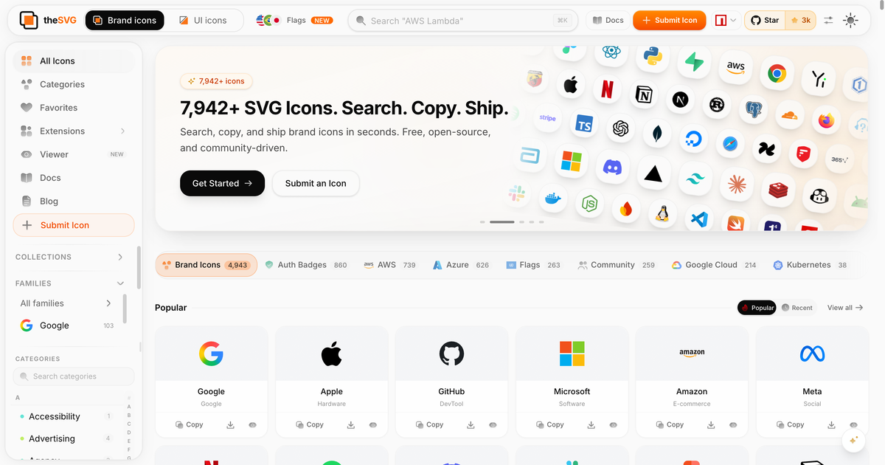
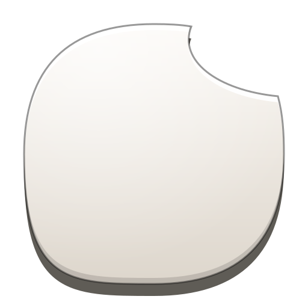

<p align="center">
  <a href="https://thesvg.org">
    <picture>
      <source media="(prefers-color-scheme: dark)" srcset="https://raw.githubusercontent.com/glincker/thesvg/main/public/logo-wordmark-dark.svg" />
      <source media="(prefers-color-scheme: light)" srcset="https://raw.githubusercontent.com/glincker/thesvg/main/public/logo-wordmark.svg" />
      
    </picture>
  </a>
</p>

<h2 align="center">오픈 SVG 브랜드 라이브러리</h2>

<p align="center">7,900개 이상의 로고, 아이콘, 국기를 SVG, React, Vue, Svelte, CDN, CLI, MCP로. 무료 오픈 소스입니다.</p>

<p align="center">
  <a href="https://trendshift.io/repositories/24396?utm_source=trendshift-badge&utm_medium=badge&utm_campaign=badge-trendshift-24396" target="_blank" rel="noopener noreferrer"></a>
</p>

<p align="center"><sub><a href="https://thesvg.org"><b>아이콘 둘러보기</b></a> · <a href="https://thesvg.org/docs">문서</a> · <a href="https://thesvg.org/collection/flags">국기</a> · <a href="https://thesvg.org/blog/country-flags">신규: 국기</a> · <a href="#빠른-시작">빠른 시작</a> · <a href="#설치">설치</a> · <a href="#확장-프로그램">확장 프로그램</a> · <a href="#cdn">CDN</a> · <a href="#api">API</a> · <a href="#패키지">패키지</a> · <a href="https://thesvg.org/compare">비교</a> · <a href="#커뮤니티">커뮤니티</a> · <a href="#기여하기">기여하기</a></sub></p>

<p align="center"><sub><a href="README.md">English</a> · <a href="README.es.md">Español</a> · <a href="README.fr.md">Français</a> · <a href="README.de.md">Deutsch</a> · <a href="README.pt-BR.md">Português</a> · <a href="README.ja.md">日本語</a> · <b>한국어</b> · <a href="README.zh-CN.md">简体中文</a> · <a href="README.ru.md">Русский</a> · <a href="README.tr.md">Türkçe</a> · <a href="README.hi.md">हिन्दी</a></sub></p>

<p align="center">
  <a href="https://www.npmjs.com/package/thesvg"></a>
  <a href="https://www.npmjs.com/package/thesvg"></a>
  <a href="https://github.com/glincker/thesvg/stargazers"></a>
  <a href="https://discord.gg/Ar5pcaZB99"></a>
  <a href="https://github.com/glincker/thesvg"></a>
  <a href="https://github.com/glincker/thesvg/blob/main/LICENSE"></a>
</p>


<p align="center">
  <a href="https://thesvg.org">
    <picture>
      <source media="(prefers-color-scheme: dark)" srcset="https://raw.githubusercontent.com/glincker/thesvg/main/public/og-image.png" />
      <source media="(prefers-color-scheme: light)" srcset="https://raw.githubusercontent.com/glincker/thesvg/main/public/og-image-light.png" />
      
    </picture>
  </a>
</p>

<!-- badges:start -->
<p align="center">
  <a href="https://www.npmjs.com/package/@thesvg/flags"></a>
  <a href="https://www.npmjs.com/package/@thesvg/mcp-server"></a>
  <a href="https://www.jsdelivr.com/package/gh/glincker/thesvg"></a>
  <a href="https://www.figma.com/community/plugin/1612997159050367763"></a>
  <a href="https://marketplace.visualstudio.com/items?itemName=glincker.thesvg"></a>
  <a href="https://www.raycast.com/thegdsks/thesvg"></a>
  <a href="https://icon-sets.iconify.design/thesvg-color/"></a>
  <a href="https://github.com/glincker/thesvg/tree/main/extensions/neovim"></a>
  <a href="https://github.com/glincker/thesvg/tree/main/extensions/alfred"></a>
  <a href="https://github.com/glincker/thesvg/tree/main/extensions/browser"></a>
  <a href="https://skills.sh/glincker/thesvg"></a>
  <a href="https://github.com/glincker/homebrew-thesvg"></a>
  <a href="https://socket.dev/npm/package/@thesvg/icons"></a>
  <a href="https://socket.dev/npm/package/thesvg"></a>
  <a href="https://www.npmjs.com/package/@thesvg/icons"></a>
</p>
<!-- badges:end -->

<p align="center">
  <sub>아래 로고는 모두 theSVG에서 바로 제공됩니다.</sub>
</p>

<p align="center">
  <a href="https://thesvg.org/icon/google"></a>&nbsp;&nbsp;&nbsp;
  <a href="https://thesvg.org/icon/docker"></a>&nbsp;&nbsp;&nbsp;
  <a href="https://thesvg.org/icon/kubernetes"></a>&nbsp;&nbsp;&nbsp;
  <a href="https://thesvg.org/icon/react"></a>&nbsp;&nbsp;&nbsp;
  <a href="https://thesvg.org/icon/vue"></a>&nbsp;&nbsp;&nbsp;
  <a href="https://thesvg.org/icon/svelte"></a>&nbsp;&nbsp;&nbsp;
  <a href="https://thesvg.org/icon/typescript"></a>&nbsp;&nbsp;&nbsp;
  <a href="https://thesvg.org/icon/tailwindcss"></a>&nbsp;&nbsp;&nbsp;
  <a href="https://thesvg.org/icon/figma"></a>&nbsp;&nbsp;&nbsp;
  <a href="https://thesvg.org/icon/stripe"></a>
</p>

<p align="center">
  <a href="https://thesvg.org/icon/slack"></a>&nbsp;&nbsp;&nbsp;
  <a href="https://thesvg.org/icon/discord"></a>&nbsp;&nbsp;&nbsp;
  <a href="https://thesvg.org/icon/spotify"></a>&nbsp;&nbsp;&nbsp;
  <a href="https://thesvg.org/icon/supabase"></a>&nbsp;&nbsp;&nbsp;
  <a href="https://thesvg.org/icon/postgresql"></a>&nbsp;&nbsp;&nbsp;
  <a href="https://thesvg.org/icon/mongodb"></a>&nbsp;&nbsp;&nbsp;
  <a href="https://thesvg.org/icon/cloudflare"></a>&nbsp;&nbsp;&nbsp;
  <a href="https://thesvg.org/icon/terraform"></a>&nbsp;&nbsp;&nbsp;
  <a href="https://thesvg.org/icon/aws"></a>&nbsp;&nbsp;&nbsp;
  <a href="https://thesvg.org/icon/microsoft-azure"></a>
</p>

<hr />


## theSVG를 만든 이유

브랜드 로고는 프레스 키트, Figma 파일, 출처를 알 수 없는 GitHub 저장소에 흩어져 있습니다. **theSVG**는 SVG 아이콘의 단일 출처입니다. 브랜드 로고, 클라우드 아키텍처 다이어그램, 그리고 직접 그린 인터페이스 아이콘 세트를 제공합니다. 검색할 수 있고, 버전 관리되며, npm 패키지, CDN, CLI, API, MCP 서버로 사용할 수 있습니다.

회사 로고를 찾아 헤매본 적 없는 개발자는 없을 겁니다. 클릭을 세 번이나 들어가야 나오는 프레스 키트, 레티나 화면에서 흐릿해지는 PNG, 알고 보니 네 가지 색이 들어 있는 "모노" 파일, 지난달에 바뀐 로고. 대부분의 아이콘 세트는 UI 글리프를 다룰 뿐, 브랜드 로고를 버전 관리되는 신뢰할 수 있는 데이터로 다루는 곳은 없었습니다.

theSVG는 그렇게 합니다. 모든 로고가 **공식 자료이고, 깨끗하고, 빠짐없이 갖춰져 있으며, 최신**인 하나의 오픈 카탈로그이고, 프로젝트에 필요한 형태로 그대로 전달됩니다.

### 만든 배경

theSVG는 풀 리퀘스트 하나에서 시작됐습니다. 우리 제품인 [AskVerdict](https://www.askverdict.ai)의 로고를 기존 오픈 소스 로고 라이브러리에 추가하려 했지만, 그 프로젝트의 범위를 벗어난다는 이유로 거절당했습니다. 엄선된 세트라면 타당한 판단입니다. 그래서 크든 작든 실존하는 브랜드라면 간단한 리뷰만으로 추가할 수 있는 카탈로그를 만들고 싶어졌습니다. 현재 theSVG에는 7,900개가 넘는 아이콘이 있으며, 모두 공식 브랜드 자료에서 가져와 병합 전에 검증합니다.

**모든 브랜드를 위한 자리.**

### theSVG 기준

카탈로그의 모든 아이콘이 따라야 하는 기준이자, 브랜드 SVG가 어디서나 이래야 한다고 우리가 생각하는 모습입니다.

| 원칙 | 실제로 의미하는 것 |
| --- | --- |
| **공식, 무수정** | 브랜드의 자체 키트나 사이트에서 가져오며, 모든 항목에 라이선스와 가이드라인 링크가 있습니다. 다시 그리지 않습니다. |
| **빠짐없는 변형** | `default`, `mono`, `light`, `dark`, `wordmark`를 일관된 이름 규칙으로 제공하므로 `{slug}/{variant}.svg`가 항상 동작합니다. |
| **정말 깨끗함** | 변경된 모든 파일에 대해 CI에서 검증기가 실행됩니다. 스크립트, 내장 래스터 이미지, `null`이나 `NaN` 값은 허용되지 않고, 모노 파일은 정말 단색이며, `viewBox`는 항상 있습니다. |
| **리브랜딩해도 이력 유지** | 브랜드가 로고를 바꾸면 새 마크가 현재 버전이 되고, 이전 버전은 `-legacy` 항목으로 남아 서로 링크됩니다. 아무것도 조용히 사라지지 않습니다. |
| **기계가 읽을 수 있음** | 정적 매니페스트, `llms.txt`, MCP 서버, 안정적인 CDN URL 덕분에 도구와 AI 어시스턴트도 사람만큼 안정적으로 로고를 사용할 수 있습니다. |
| **누구에게나 열려 있음** | MIT 코드, 계정 없음, API 키 없음, 진입 장벽 없음. 실존하는 브랜드라면 이곳에 자리가 있습니다. |

바라던 로고 라이브러리가 바로 이런 것이라면, 가장 도움이 되는 일은 **[저장소에 Star 누르기](https://github.com/glincker/thesvg)**입니다. 다른 개발자들이 이 프로젝트를 발견하는 방법이 됩니다.

<table>
  <tr>
    <td align="center" width="25%"><strong><!-- flags:total-icons -->7,900+<!-- /flags:total-icons --></strong><br />아이콘</td>
    <td align="center" width="25%"><strong><!-- flags:total-variants -->14,700+<!-- /flags:total-variants --></strong><br />변형: 컬러, 모노, 라이트, 다크, 워드마크, 국기 모양</td>
    <td align="center" width="25%"><strong>150+</strong><br />카테고리</td>
    <td align="center" width="25%"><strong>21</strong><br />브랜드 패밀리</td>
  </tr>
</table>

### 수록 내용

| &nbsp;&nbsp;&nbsp;&nbsp;&nbsp;&nbsp;&nbsp; | 컬렉션 | 아이콘 수 | 제공 내용 |
| --- | --- | --- | --- |
| <picture><source media="(prefers-color-scheme: dark)" srcset="https://cdn.jsdelivr.net/gh/glincker/thesvg@main/public/icons/github/dark.svg" /></picture> | [브랜드 아이콘](https://thesvg.org/collection/brands) | 4,800+ | 150개 이상 카테고리의 로고를 컬러, 모노, 라이트, 다크, 워드마크로 제공 |
| <picture><source media="(prefers-color-scheme: dark)" srcset="https://cdn.jsdelivr.net/gh/glincker/thesvg@main/public/icons/1password/dark.svg" /></picture> | [인증 배지](https://thesvg.org/collection/auth-badges) | 858 | 2FA 및 인증 앱 UI용 원형 배지 |
|  | [AWS 아키텍처](https://thesvg.org/collection/aws) | 739 | 공식 AWS 서비스 및 리소스 아이콘 |
|  | [Azure](https://thesvg.org/collection/azure) | 626 | Microsoft Azure 서비스 아이콘 |
|  | [커뮤니티](https://thesvg.org/collection/community) | 256 | 개발 도구, 데이터베이스, 프레임워크 |
|  | [Google Cloud](https://thesvg.org/collection/gcp) | 214 | Google Cloud Platform 아이콘 |
|  | [Kubernetes](https://thesvg.org/collection/k8s) | 38 | 공식 CNCF 아키텍처 아이콘 |

<details>
<summary>컬렉션 (일반 표)</summary>

theSVG는 아이콘을 컬렉션으로 정리합니다.

| 컬렉션 | 아이콘 수 | 설명 |
|------------|-------|-------------|
| **브랜드 아이콘** | 4,800+ | 150개 이상 카테고리의 브랜드 로고 |
| **인증 배지** | 858 | 2FA/인증 앱에 맞게 디자인된 원형 아이콘 배지 |
| **AWS 아키텍처** | 739 | 공식 AWS 서비스, 리소스, 카테고리, 그룹 아이콘 (2026-Q1) |
| **Azure 서비스** | 626 | Microsoft Azure 서비스 아이콘 (2026-Q1) |
| **커뮤니티** | 256 | 오픈 소스 커뮤니티에서 가져온 개발 도구, 데이터베이스, 프레임워크 |
| **Google Cloud** | 214 | Google Cloud Platform 아이콘 (2026-Q1) |
| **Kubernetes** | 38 | 공식 Kubernetes/CNCF 아키텍처 아이콘 |
| **국기** | <!-- flags:count -->263<!-- /flags:count --> | 4x3, 정사각형, 원형의 국가 및 지역 국기 (카테고리 `Flags`, 슬러그 `flag-us`, `flag-gb-eng`) |

</details>

### UI 아이콘

**theSVG 4.0 신규.** 브랜드 카탈로그와 함께, theSVG는 **직접 그린 인터페이스 아이콘**을 [thesvg.org/ui](https://thesvg.org/ui)에서 제공합니다. 현재 129개이며, 각각 일곱 가지 스타일(아웃라인, 글래스, 듀오톤, 오프셋, 필, 글래스 아웃라인, 뎁스)로 제공되고 모두 `currentColor`를 사용합니다. 앞으로도 조금씩 추가됩니다. 별도의 섹션으로서 전용 데이터, 패키지, 테스트를 갖추고 있어, 두 종류의 아이콘이 데이터나 코드를 섞는 일은 없습니다. 아래 [UI 아이콘](#ui-아이콘-1)을 참고하세요.

### 브랜드 패밀리

제품을 소유한 회사별로 묶어 두었기 때문에 Google, Microsoft, Amazon, Apple의 제품 라인을 모든 변형과 함께 한곳에서 볼 수 있습니다. 21개 전체는 [thesvg.org/families](https://thesvg.org/families)에서 확인하세요.

<table>
  <tr>
    <td align="center"><a href="https://thesvg.org/family/google"><br /><b>Google</b></a><br /><sub>100+ 로고</sub></td>
    <td align="center"><a href="https://thesvg.org/family/microsoft"><br /><b>Microsoft</b></a><br /><sub>70+ 로고</sub></td>
    <td align="center"><a href="https://thesvg.org/family/adobe"><br /><b>Adobe</b></a><br /><sub>30+ 로고</sub></td>
    <td align="center"><a href="https://thesvg.org/family/amazon"><br /><b>Amazon</b></a><br /><sub>18 로고</sub></td>
    <td align="center"><a href="https://thesvg.org/family/apple"><picture><source media="(prefers-color-scheme: dark)" srcset="https://cdn.jsdelivr.net/gh/glincker/thesvg@main/public/icons/apple/dark.svg" /></picture><br /><b>Apple</b></a><br /><sub>16 로고</sub></td>
    <td align="center"><a href="https://thesvg.org/family/jetbrains"><br /><b>JetBrains</b></a><br /><sub>16 로고</sub></td>
    <td align="center"><a href="https://thesvg.org/family/ibm"><br /><b>IBM</b></a><br /><sub>14 로고</sub></td>
  </tr>
</table>

전체 내역은 [컬렉션, 패밀리, 카테고리](./docs/collections.md)에 있습니다.

### 주요 특징

- **<!-- flags:total-icons -->7,900+<!-- /flags:total-icons -->개 아이콘**, 여러 컬렉션에 걸쳐 제공
- **4,800개 이상의 브랜드 아이콘**, 150개 이상 카테고리
- **21개 브랜드 패밀리**: Amazon, Google, Microsoft 등의 모든 제품을 소유자별로 묶음
- **858개 인증 배지 아이콘**: 2FA/인증 앱용 원형 아이콘 배지
- **739개 AWS 아키텍처 아이콘** (2026-Q1)
- **626개 Azure 서비스 아이콘** (2026-Q1)
- **256개 커뮤니티 엄선 아이콘**: 개발 도구, 데이터베이스, 프레임워크
- **214개 Google Cloud 아이콘** (2026-Q1)
- **<!-- flags:count -->263<!-- /flags:count -->개 국가 및 지역 국기**: ISO 3166-1에 더해 잉글랜드, 스코틀랜드, 웨일스, 카탈루냐 등. 4x3, 정사각형, 원형
- **<!-- flags:total-variants -->14,700+<!-- /flags:total-variants -->개 SVG 변형**: 컬러, 모노, 라이트, 다크, 워드마크, 국기 모양
- **트리 셰이킹 지원**: 아이콘 하나만 import하면 그 아이콘만 배포됩니다
- **TypeScript 우선**: 완전한 타입 지원, ESM/CJS 이중 지원
- **프레임워크 독립**: React, Vue, Svelte, 순수 HTML, CDN 모두 가능
- **AI 지원**: Claude, Cursor, Windsurf용 MCP 서버

### 국기

[thesvg.org/collection/flags](https://thesvg.org/collection/flags)에서 둘러볼 수 있습니다. ISO 3166-1의 모든 국가에 더해 잉글랜드, 스코틀랜드, 웨일스, 카탈루냐, 바스크, 갈리시아, 발렌시아 자치지방, 발레아레스 제도, 카나리아 제도, 코르시카, 오크시타니아, EU, UN을 세 가지 모양으로 제공합니다. 슬러그는 `flag-<code>`(`flag-us`, `flag-gb-eng`)이고, 변형은 `default`(4x3), `square`, `circle`입니다.

```bash
npm i @thesvg/flags
```

```tsx
import { FlagUs } from "@thesvg/flags/react/us";
import { getFlagForLocale } from "@thesvg/flags/locale";

<FlagUs variant="circle" size={32} />
```

일반 이미지로 쓸 때는 설치가 필요 없습니다: `https://cdn.jsdelivr.net/npm/@thesvg/flags/dist/svg/4x3/us.svg` (다른 모양은 `1x1` 또는 `circle` 사용).

사이트에서는 모든 국기에 전용 페이지(`/icon/flag-us`)가 있어 색상 팔레트, 복사 및 다운로드 버튼, 사용법 카드(npm, CLI, CDN), 크롤링 가능한 정보를 볼 수 있습니다. 컬렉션 페이지에서는 지역, 색상, 로케일로 필터링할 수 있고, 헤더 검색에서는 국기가 별도 섹션에 나와 브랜드 아이콘이 먼저 보입니다.

국기는 국가를 나타내는 것이지 언어를 나타내는 것이 아닙니다. 옆에 해당 언어의 이름을 함께 표시하세요. 가이드: [docs/flags.md](./docs/flags.md).

### AWS 아키텍처 아이콘

모든 AWS 서비스 및 리소스 아이콘은 [thesvg.org/collection/aws](https://thesvg.org/collection/aws)에서 볼 수 있습니다. 아이콘은 공식 [AWS Architecture Icons](https://aws.amazon.com/architecture/icons/) 패키지에서 가져와 [CC BY-ND 2.0](https://creativecommons.org/licenses/by-nd/2.0/) 라이선스로 수정 없이 배포합니다. 분기마다 업데이트됩니다.

### 인증 배지

전체 세트는 [thesvg.org/collection/auth-badges](https://thesvg.org/collection/auth-badges)에서 볼 수 있습니다. 인증 앱 목록과 2FA UI를 위해 디자인된 원형의 플랫 컬러 배지 아이콘으로, 위의 기본 브랜드 마크 컬렉션과는 다른 시각 스타일입니다. CC0-1.0(퍼블릭 도메인)으로 배포됩니다.

<details>
<summary>브랜드 패밀리 전체 표</summary>

제품을 소유한 회사별로 묶었으며 각각 전용 페이지가 있습니다. Amazon, Google, Microsoft의 전체 제품 라인을 모든 변형과 함께 한곳에서 볼 수 있습니다.

| 패밀리 | 로고 수 | 포함 항목 |
| --- | --- | --- |
| [Google](https://thesvg.org/family/google) | 100+ | Workspace, Gemini, Cloud, Android, Chrome |
| [Microsoft](https://thesvg.org/family/microsoft) | 70+ | GitHub, Azure, Dynamics 365, Fabric, Copilot |
| [Adobe](https://thesvg.org/family/adobe) | 30+ | Photoshop, Illustrator, Creative Cloud |
| [Amazon](https://thesvg.org/family/amazon) | 18 | Prime, Kindle, Music, AWS, Twitch, Ring |
| [Apple](https://thesvg.org/family/apple) | 16 | iOS, macOS, Music, iCloud |
| [JetBrains](https://thesvg.org/family/jetbrains) | 16 | IntelliJ IDEA, PyCharm, WebStorm, Rider |
| [IBM](https://thesvg.org/family/ibm) | 14 | Red Hat, HashiCorp, Terraform, Ansible |

21개 패밀리 전체는 [thesvg.org/families](https://thesvg.org/families)에서 확인하세요. 같은 데이터를 JSON으로 [`/api/families.json`](https://thesvg.org/api/families.json)과 [`llms.txt`](https://thesvg.org/llms.txt)에서도 제공합니다.

</details>

## 빠른 시작

```bash
# Add a single icon to your project
npx @thesvg/cli add github

# Or install the package and import only what you use
npm install thesvg
```

```ts
import github from "thesvg/github";

github.svg;      // raw SVG string
github.title;    // "GitHub"
github.hex;      // "181717"
```

```html
<!-- Or use the CDN, no install -->

```

모든 아이콘에는 전용 페이지가 있어 모든 변형, 복사 형식, 실시간 미리보기를 볼 수 있습니다. 예: [thesvg.org/icon/github](https://thesvg.org/icon/github). 트리 셰이킹 지원, 완전한 타입 지원, ESM과 CJS 모두 지원합니다. 자세한 내용은 [설치 및 패키지](./docs/install.md), [사용법 및 변형](./docs/usage.md), [CDN 및 API](./docs/cdn-api.md)를 참고하세요.

## 디자이너와 개발자를 위해

<table>
  <tr>
    <td width="50%" valign="top">
      <h4> 디자인한다면</h4>
      <ul>
        <li><a href="https://www.figma.com/community/plugin/1612997159050367763">Figma 플러그인</a>으로 공식 로고를 Figma에 <b>편집 가능한 벡터</b>로 바로 넣을 수 있습니다.</li>
        <li>배경에 맞는 변형을 고르세요: 컬러, 모노, 라이트, 다크, 워드마크.</li>
        <li>다시 그릴 필요도, 색을 짐작할 필요도 없습니다. 모든 마크는 브랜드 자체의 것이며 가이드라인 링크가 함께 제공됩니다.</li>
        <li>다이어그램을 그리나요? Mermaid에서 <a href="https://icon-sets.iconify.design/thesvg-color/">Iconify 세트</a>를 쓰고, draw.io와 Excalidraw 라이브러리, AWS, Azure, Google Cloud 아키텍처 아이콘도 사용해 보세요.</li>
      </ul>
    </td>
    <td width="50%" valign="top">
      <h4> 개발한다면</h4>
      <ul>
        <li>아이콘 하나를 import하면 아이콘 하나만 배포됩니다: <code>thesvg/github</code>는 트리 셰이킹을 지원하고 완전한 타입을 갖추고 있습니다.</li>
        <li><a href="https://www.npmjs.com/package/@thesvg/react">React</a>, <a href="https://www.npmjs.com/package/@thesvg/vue">Vue</a>, <a href="https://www.npmjs.com/package/@thesvg/svelte">Svelte</a> 컴포넌트를 쓰거나, CDN의 순수 <code>&lt;img&gt;</code>를 사용할 수 있습니다.</li>
        <li>터미널에서 <a href="https://www.npmjs.com/package/@thesvg/cli">CLI</a>로 아이콘을 추가하거나, AI 에디터가 <a href="https://www.npmjs.com/package/@thesvg/mcp-server">MCP 서버</a>로 직접 가져오게 할 수 있습니다.</li>
        <li>안정적인 URL과 정적 JSON 매니페스트가 있어서 키나 가입 없이 바로 그 위에 만들 수 있습니다.</li>
      </ul>
    </td>
  </tr>
</table>

## 설치

**npm**

```bash
npm install thesvg
```

**Homebrew**

```bash
brew tap glincker/thesvg
brew install thesvg
```

```ts
import github from "thesvg/github";

github.svg;        // raw SVG string
github.title;      // "GitHub"
github.hex;        // "181717"
github.variants;   // { default: "<svg...>", mono: "<svg...>" }
```

트리 셰이킹을 하려면 스코프 패키지를 사용하세요.

```bash
npm install @thesvg/icons
```

## 패키지

모든 패키지는 트리 셰이킹을 지원하고, 완전한 타입을 갖추었으며, ESM과 CJS를 함께 제공합니다. 스택에 맞는 것을 고르세요. 브랜드 아이콘과 UI 아이콘은 별도 패키지(`@thesvg/ui*`)이므로 하나를 추가해도 다른 쪽이 무거워지지 않습니다.

| &nbsp;&nbsp;&nbsp;&nbsp;&nbsp;&nbsp;&nbsp; | 패키지 | 버전 | 다운로드 | 설명 | 설치 |
| --- | --- | --- | --- | --- | --- |
|  | [`thesvg`](https://www.npmjs.com/package/thesvg) | [](https://www.npmjs.com/package/thesvg) | [](https://www.npmjs.com/package/thesvg) | 모든 아이콘을 하나의 패키지로 | `npm install thesvg` |
|  | [`@thesvg/icons`](https://www.npmjs.com/package/@thesvg/icons) | [](https://www.npmjs.com/package/@thesvg/icons) | [](https://www.npmjs.com/package/@thesvg/icons) | 핵심 아이콘 데이터, 트리 셰이킹 지원 | `npm install @thesvg/icons` |
|  | [`@thesvg/react`](https://www.npmjs.com/package/@thesvg/react) | [](https://www.npmjs.com/package/@thesvg/react) | [](https://www.npmjs.com/package/@thesvg/react) | 타입이 지정된 React 컴포넌트 | `npm install @thesvg/react` |
|  | [`@thesvg/vue`](https://www.npmjs.com/package/@thesvg/vue) | [](https://www.npmjs.com/package/@thesvg/vue) | [](https://www.npmjs.com/package/@thesvg/vue) | 타입이 지정된 Vue 3 컴포넌트 | `npm install @thesvg/vue` |
|  | [`@thesvg/svelte`](https://www.npmjs.com/package/@thesvg/svelte) | [](https://www.npmjs.com/package/@thesvg/svelte) | [](https://www.npmjs.com/package/@thesvg/svelte) | 타입이 지정된 Svelte 컴포넌트 | `npm install @thesvg/svelte` |
|  | [`@thesvg/react-native`](https://www.npmjs.com/package/@thesvg/react-native) | [](https://www.npmjs.com/package/@thesvg/react-native) | [](https://www.npmjs.com/package/@thesvg/react-native) | React Native 컴포넌트 | `npm install @thesvg/react-native` |
|  | [`@thesvg/ui`](https://www.npmjs.com/package/@thesvg/ui) | [](https://www.npmjs.com/package/@thesvg/ui) | [](https://www.npmjs.com/package/@thesvg/ui) | UI 아이콘: 원본 SVG 파일과 JSON 매니페스트 | `npm install @thesvg/ui` |
|  | [`@thesvg/ui-react`](https://www.npmjs.com/package/@thesvg/ui-react) | [](https://www.npmjs.com/package/@thesvg/ui-react) | [](https://www.npmjs.com/package/@thesvg/ui-react) | 타입이 지정된 React 컴포넌트로 제공하는 UI 아이콘 | `npm install @thesvg/ui-react` |
|  | [`@thesvg/ui-vue`](https://www.npmjs.com/package/@thesvg/ui-vue) | [](https://www.npmjs.com/package/@thesvg/ui-vue) | [](https://www.npmjs.com/package/@thesvg/ui-vue) | Vue 3 컴포넌트로 제공하는 UI 아이콘 | `npm install @thesvg/ui-vue` |
|  | [`@thesvg/ui-svelte`](https://www.npmjs.com/package/@thesvg/ui-svelte) | [](https://www.npmjs.com/package/@thesvg/ui-svelte) | [](https://www.npmjs.com/package/@thesvg/ui-svelte) | Svelte 컴포넌트로 제공하는 UI 아이콘 | `npm install @thesvg/ui-svelte` |
|  | [`@thesvg/ui-react-native`](https://www.npmjs.com/package/@thesvg/ui-react-native) | [](https://www.npmjs.com/package/@thesvg/ui-react-native) | [](https://www.npmjs.com/package/@thesvg/ui-react-native) | React Native용 UI 아이콘 | `npm install @thesvg/ui-react-native` |
|  | [`@thesvg/cli`](https://www.npmjs.com/package/@thesvg/cli) | [](https://www.npmjs.com/package/@thesvg/cli) | [](https://www.npmjs.com/package/@thesvg/cli) | CLI 도구, shadcn 방식의 설치 도구 | `npx @thesvg/cli add github` |
|  | [`@thesvg/mcp-server`](https://www.npmjs.com/package/@thesvg/mcp-server) | [](https://www.npmjs.com/package/@thesvg/mcp-server) | [](https://www.npmjs.com/package/@thesvg/mcp-server) | AI 어시스턴트용 MCP 서버 | `npx @thesvg/mcp-server` |

## 확장 프로그램

만들고, 디자인하고, 배포하는 모든 곳에서 theSVG 아이콘을 사용하세요. 전체 생태계는 [thesvg.org/extensions](https://thesvg.org/extensions)에서 확인할 수 있습니다.

| &nbsp;&nbsp;&nbsp;&nbsp;&nbsp;&nbsp;&nbsp; | 확장 프로그램 | 상태 | 기능 |
| --- | --- | --- | --- |
|  | [Figma 플러그인](https://www.figma.com/community/plugin/1612997159050367763) |  | 7,600개 이상의 브랜드 SVG 탐색, 변형 선택, 최근 항목, 단축키를 지원합니다. 편집 가능한 벡터로 삽입할 수 있습니다. |
|  | [VS Code](https://marketplace.visualstudio.com/items?itemName=glincker.thesvg) |  | 명령 팔레트에서 7,600개 이상의 아이콘을 검색합니다. SVG, JSX, CDN 링크를 복사하거나 커서 위치에 삽입할 수 있습니다. |
|  | [Raycast](https://www.raycast.com/thegdsks/thesvg) |  | 키 입력 한 번으로 브랜드 SVG를 검색, 미리보기, 복사합니다. 카테고리별 필터링과 변형 미리보기를 지원합니다. |
|  | [MCP 서버](https://www.npmjs.com/package/@thesvg/mcp-server) |  | Claude, Cursor, Windsurf용 AI 도구 호출. 이름이나 카테고리로 아이콘을 가져옵니다. |
|  | [에이전트 스킬](https://skills.sh/glincker/thesvg) |  | AI 에이전트용 바로 쓸 수 있는 스킬. `npx skills add glincker/thesvg`로 설치합니다. 아이콘 CDN과 레지스트리 사용법을 알려 줍니다. |
|  | [`@thesvg/cli`](https://www.npmjs.com/package/@thesvg/cli) |  | shadcn 방식의 설치 도구. `npx @thesvg/cli add github`로 SVG를 프로젝트에 추가합니다. |
|  | [Homebrew](https://github.com/glincker/homebrew-thesvg) |  | `brew tap glincker/thesvg && brew install thesvg` |
|  | [jsDelivr CDN](https://www.jsdelivr.com/package/gh/glincker/thesvg) |  | 글로벌 CDN으로 아이콘을 제공합니다. HTML, CSS, Markdown, Notion, Webflow, Framer에 바로 넣을 수 있습니다. |
|  | [Iconify](https://icon-sets.iconify.design/thesvg-color/) |  | 브랜드 아이콘을 [`thesvg`](https://icon-sets.iconify.design/thesvg/) (모노)와 [`thesvg-color`](https://icon-sets.iconify.design/thesvg-color/) 세트로 제공합니다. Iconify를 사용하는 모든 도구에서 작동합니다: Mermaid 아키텍처 다이어그램, Iconify의 VS Code 및 Figma 플러그인, `@iconify/react` 등. |
|  | [브라우저 확장 프로그램](https://github.com/glincker/thesvg/tree/main/extensions/browser) |  | 7,600개 이상의 브랜드 SVG를 담은 Chrome, Firefox, Edge 팝업. MV3, 텔레메트리 없음. |
|  | [JetBrains](https://github.com/glincker/thesvg/issues?q=label%3Aextension) |  | IntelliJ, WebStorm, PyCharm, Rider 도구 창. 도움을 구합니다. |
|  | [Neovim](https://github.com/glincker/thesvg/tree/main/extensions/neovim) |  | Telescope 피커를 갖춘 Lua 플러그인. SVG URL 또는 인라인 내용을 커서 위치에 삽입합니다. |
|  | [Alfred 워크플로](https://github.com/glincker/thesvg/tree/main/extensions/alfred) |  | macOS에서 빠르게 접근합니다. 어디서든 검색하고 SVG, CDN URL, 마크다운을 복사할 수 있습니다. |
| <picture><source media="(prefers-color-scheme: dark)" srcset="https://cdn.jsdelivr.net/gh/glincker/thesvg@main/public/icons/sketch/dark.svg" /></picture> | [Sketch / Blender / Webflow / Notion](https://github.com/glincker/thesvg/issues?q=label%3Aextension) |  | 추적용 이슈가 열려 있습니다. 플러그인을 만들어 주시면 여기에 올려 드리겠습니다. |

> **확장 프로그램의 UI 아이콘:** CLI, MCP 서버, VS Code, 브라우저 확장 프로그램, Alfred, Neovim은 브랜드 아이콘뿐 아니라 UI 아이콘도 검색합니다. Figma와 Raycast는 출시 이후에 지원합니다. 각 확장 프로그램은 UI 아이콘을 별도 파일에서 읽으므로 브랜드 검색에는 영향을 주지 않습니다.

> **직접 만들기:** API와 CDN은 인증 없이 완전히 열려 있습니다. 플러그인이나 워크플로를 만든 뒤 PR을 열어 주시면 표에 추가하겠습니다.

## 사용법

<details>
<summary>React, Vue, Svelte, CDN, CLI 예제</summary>

### React

```tsx
import { Github, Figma } from "@thesvg/react";

export function Logos() {
  return <Github width={24} height={24} className="text-white" />;
}
```

### Vue

```vue
<script setup>
import { Github, Figma } from "@thesvg/vue";
</script>

<template>
  <Github width="24" height="24" />
</template>
```

### Svelte

```svelte
<script>
  import { Github, Figma } from "@thesvg/svelte";
</script>

<Github width="24" height="24" />
```

### CDN

```html

```

### CLI

```bash
npx @thesvg/cli add github
npx @thesvg/cli search "ai"
```

</details>

## 변형

아이콘은 어떤 디자인 상황에도 맞도록 최대 7가지 변형을 지원합니다.

| 변형 | 키 | 설명 |
|---------|-----|-------------|
| 기본 | `default` | 기본 브랜드 색상 |
| 모노 | `mono` | 텍스트 색상을 상속 |
| 라이트 | `light` | 밝은 배경용 어두운 채우기 |
| 다크 | `dark` | 어두운 배경용 밝은 채우기 |
| 워드마크 | `wordmark` | 텍스트 전체 로고 |
| 워드마크 라이트 | `wordmarkLight` | 흰색 텍스트 로고 |
| 워드마크 다크 | `wordmarkDark` | 어두운 텍스트 로고 |

모든 아이콘에 모든 변형이 있는 것은 아닙니다. `default`는 항상 있습니다.

## UI 아이콘

직접 그린 인터페이스 아이콘을 일곱 가지 스타일로 제공합니다. [thesvg.org/ui](https://thesvg.org/ui)에서 둘러보세요.

```bash
npm install @thesvg/ui-react
```

```tsx
import { BellIcon, BellGlassIcon } from "@thesvg/ui-react";

// Outline is the plain name, every other look adds its name.
<BellIcon size={24} aria-label="Notifications" />
<BellGlassIcon size={32} />
```

스타일마다 export가 하나씩 있으므로 import하지 않은 스타일은 번들에 포함되지 않습니다. Vue, Svelte, React Native 패키지도 같은 이름 규칙을 따릅니다(`@thesvg/ui-vue`, `@thesvg/ui-svelte`, `@thesvg/ui-react-native`).

| 항목 | 위치 |
|------|-------|
| 아이콘 파일 하나 | `https://thesvg.org/ui/{slug}/{look}.svg` |
| 한 스타일의 모든 아이콘 | `https://cdn.jsdelivr.net/gh/glincker/thesvg@main/src/data/ui/looks/{look}.json` |
| 매니페스트 (슬러그, 태그, 카테고리, 품질) | `https://cdn.jsdelivr.net/gh/glincker/thesvg@main/src/data/ui-icons.json` |
| CLI | `npx @thesvg/cli add ui:bell --look glass` |

스타일: `outline`, `glass`, `duotone`, `offset`, `fill`, `glass-outline`, `depth`. UI 아이콘은 직접 그린 원본이며, 나머지 코드와 마찬가지로 [MIT 라이선스](./LICENSE)로 공개됩니다. 아이콘을 추가하거나 수정하려면 [UI 아이콘 기여](./CONTRIBUTING.md#ui-icons)를 참고하세요.

## CDN

설치 없이 아이콘을 바로 사용할 수 있습니다.

```html
<!-- From thesvg.org -->


<!-- From jsDelivr -->

```

**URL 패턴:** `https://thesvg.org/icons/{slug}/{variant}.svg`

## API

<details>
<summary>정적 매니페스트, 미러, 예제</summary>

thesvg는 CDN에서 제공되는 완전한 정적 사이트입니다. 동적 API는 없으며, 대신 미리 빌드된 JSON 매니페스트로 모든 사용 사례를 처리합니다. 검색, 필터링, 페이지 나누기는 클라이언트에서 이루어집니다.

기본 URL: `https://thesvg.org`

| 엔드포인트 | 설명 |
|----------|-------------|
| `GET /api/registry.json` | 전체 아이콘 매니페스트 (슬러그, 제목, 별칭, 카테고리, hex, url, 변형 키) |
| `GET /api/categories.json` | 개수가 포함된 카테고리 목록 |
| `GET /icons/{slug}/{variant}.svg` | 원본 SVG 파일 (예: `/icons/openai/default.svg`) |

```bash
# Fetch the manifest once, filter client-side
curl "https://thesvg.org/api/registry.json" | jq '.icons[] | select(.slug | contains("openai"))'

# Then pull the SVG you want
curl "https://thesvg.org/icons/openai/default.svg"
```

### 미러

트래픽이 많은 앱에서는 `thesvg.org`를 직접 호출하는 대신 jsDelivr(무료, GitHub 기반)를 사용하세요.

```
https://cdn.jsdelivr.net/gh/glincker/thesvg@main/src/data/icons.json
https://cdn.jsdelivr.net/gh/glincker/thesvg@main/public/icons/{slug}/{variant}.svg
```

`src/data/icons.json`이 기준이 되는 매니페스트입니다(`/api/registry.json`을 만드는 것과 같은 데이터이며, `license`와 `dateAdded`를 포함한 아이콘별 전체 필드가 있습니다).

저장소(약 30 MB)를 클론해서 직접 호스팅할 수도 있습니다. 코드베이스는 MIT 라이선스이며, 개별 브랜드 아이콘은 각 소유자의 상표로 남습니다([LEGAL.md](./LEGAL.md) 참고).

> 고급 기능(검색 관련도, 사용량 분석, 웹훅)을 위한 토큰 기반 API를 `api.thesvg.org`에서 제공할 계획입니다. 그때까지는 위의 정적 매니페스트가 공식 지원하는 연동 방법입니다.

</details>

## 카테고리

아이콘은 150개 이상의 카테고리로 정리되어 있습니다.

`AI` `Analytics` `Identity` `Automotive` `Aviation` `Browser` `Cloud` `CMS` `Community` `Crypto` `Database` `Design` `DevTool` `Education` `Entertainment` `Finance` `Food` `Framework` `Gaming` `Hardware` `Hosting` `IoT` `Language` `Library` `Linux` `Media` `Music` `Payment` `Platform` `Privacy` `Security` `Self-Hosted` `Shopping` `Social` `Software` 그 외 다수

## 커뮤니티

질문, 아이콘 요청, 만든 것을 자랑하고 싶다면 공식 GLINR Discord에 참여하세요. theSVG와 모든 GLINR Studios 오픈 소스 프로젝트의 공간입니다. theSVG 전용 포럼이 있고, 새 릴리스는 자동으로 올라옵니다.

<a href="https://discord.gg/Ar5pcaZB99"></a>

## 로컬에서 실행하기

[Node.js](https://nodejs.org) 20 이상과 [pnpm](https://pnpm.io)이 필요합니다.

```bash
git clone https://github.com/glincker/thesvg.git
cd thesvg
pnpm install
pnpm dev          # http://localhost:3333
```

| 명령어 | 기능 |
| --- | --- |
| `pnpm dev` | 3333 포트에서 핫 리로드와 함께 사이트를 시작합니다 |
| `pnpm build` | API, `llms.txt`, 피드, 아이콘 톤을 다시 생성한 뒤 정적 사이트를 빌드합니다 |
| `pnpm lint` | ESLint를 실행합니다 |
| `pnpm test` | Vitest 스위트와 CLI 및 icons 패키지 테스트를 실행합니다 |
| `npx tsx scripts/validate-icons.ts` | 모든 SVG에서 스크립트, 잘못된 값, 단색이 아닌 모노 파일, 누락된 `viewBox`를 검사합니다 |

**아이콘 추가하기:** `public/icons/{slug}/`에 파일을 넣고(`default.svg`, 필요에 따라 `mono`, `light`, `dark`, `wordmark`), `src/data/icons.json`에 슬러그를 등록한 뒤 검증기를 실행하고 풀 리퀘스트를 여세요. 전체 규칙은 [CONTRIBUTING.md](./CONTRIBUTING.md)에 있습니다.

## 기여하기

모든 브랜드는 자리를 가질 자격이 있습니다. 진입 장벽은 없습니다.

**아이콘 제출:** [thesvg.org/submit](https://thesvg.org/submit)에서 하거나 [풀 리퀘스트](https://github.com/glincker/thesvg/pulls)를 여세요.

**개발 환경 설정:**

```bash
git clone https://github.com/glincker/thesvg.git
cd thesvg
pnpm install
pnpm dev     # http://localhost:3333
```

**UI 아이콘**은 별도의 흐름이 있습니다. `src/data/ui/sets`의 세트 파일을 수정하고, `pnpm ui:build`를 실행한 뒤 `pnpm test:ui`로 테스트하세요. 브랜드 작업은 계속 `pnpm test:brand`를 사용합니다. 전체 가이드라인은 [CONTRIBUTING.md](./CONTRIBUTING.md)를 참고하세요.

질문과 아이콘 요청은 [Discord](https://discord.gg/Ar5pcaZB99)에서 환영합니다.

## 기여자

<a href="https://github.com/glincker/thesvg/graphs/contributors">
  
</a>

## 소식 받기

새 아이콘, 리브랜딩, 릴리스가 매주 추가됩니다. 소식을 놓치지 않으려면:

- 저장소에 **Star를 누르고 Watch**하세요. *Watch, Custom, Releases*를 사용하면 새 버전이 나올 때마다 알림을 받을 수 있습니다.
- GitHub에서 **[GLINR Studios](https://github.com/glincker)를 팔로우**하면 우리가 만드는 다른 프로젝트도 볼 수 있습니다.
- **[Discord](https://discord.gg/Ar5pcaZB99)에 참여**해서 아이콘을 요청하고 릴리스 소식을 바로 받아 보세요.
- **[thesvg.org](https://thesvg.org)를 둘러보며** 최근에 추가된 것을 확인하세요.

## 후원

theSVG는 호스팅, 대역폭, 메인테이너의 시간으로 운영됩니다. 이 카탈로그가 1년에 몇 시간이라도 아껴 준다면 [티어를 선택](./SPONSORS.md)해서 그 가치를 지켜 주세요. 티어는 월 $5부터 시작하며 Sketch부터 Canvas까지 단계별로 이어집니다.

[GitHub에서 후원하기](https://github.com/sponsors/glincker)

## 지원

theSVG는 호스팅, 대역폭, 메인테이너의 시간으로 운영됩니다. [GitHub에서 후원](https://github.com/sponsors/glincker)하거나 저장소에 Star를 눌러 다른 개발자들이 찾을 수 있게 해 주세요.

<p align="center">
  <a href="https://github.com/glincker/thesvg"></a>
</p>

<a href="https://star-history.com/#glincker/thesvg&Date">
  <picture>
    <source media="(prefers-color-scheme: dark)" srcset="https://api.star-history.com/svg?repos=glincker/thesvg&type=Date&theme=dark" />
    <source media="(prefers-color-scheme: light)" srcset="https://api.star-history.com/svg?repos=glincker/thesvg&type=Date" />
    
  </picture>
</a>

## 면책 조항

모든 브랜드 이름, 로고, 상표는 각 소유자의 자산입니다. theSVG는 지명적 공정 사용(nominative fair use)에 따라 개발과 디자인 목적으로만 이 아이콘들을 제공합니다. 브랜드 자산의 사용은 각 브랜드의 사용 가이드라인을 따라야 합니다.

AWS Architecture Icons는 [CC BY-ND 2.0](https://creativecommons.org/licenses/by-nd/2.0/)(변경 금지) 라이선스로 제공됩니다. Amazon Web Services 및 관련된 모든 마크는 Amazon.com, Inc.의 상표입니다.

브랜드 소유자이고 아이콘의 업데이트나 삭제를 원하시면 [이슈를 열거나](https://github.com/glincker/thesvg/issues) **support@glinr.com**으로 이메일을 보내 주세요. 자세한 내용은 [법적 고지](https://thesvg.org/legal), [TRADEMARK.md](./TRADEMARK.md), [LEGAL.md](./LEGAL.md)를 참고하세요.

## 라이선스

코드베이스, 도구, UI 아이콘은 [MIT](./LICENSE)입니다. 개별 브랜드 아이콘의 지식재산권은 각 상표권자에게 있습니다.

---

<!-- footer-tagline:start -->
<p align="center"><b>오픈 SVG 브랜드 라이브러리</b><br />로고의 권리는 각 소유자에게 있습니다. theSVG는 인기 아이콘부터 자주 쓰는 아이콘까지 실제로 필요한 것을 한곳에 모은 카탈로그라서 다른 사이트를 찾아다닐 필요가 없습니다. 카탈로그는 계속 늘어나고 있습니다.</p>
<!-- footer-tagline:end -->

<p align="center">
  <a href="https://thesvg.org">thesvg.org</a> &nbsp;&bull;&nbsp;
  <a href="./docs/install.md">설치</a> &nbsp;&bull;&nbsp;
  <a href="./docs/extensions.md">확장 프로그램</a> &nbsp;&bull;&nbsp;
  <a href="https://github.com/glincker/thesvg/issues">이슈</a>
</p>

<p align="center"><sub>GLINR Studios가 만들었습니다. 팀의 다른 프로젝트:</sub></p>

<table align="center">
  <tr>
    <td align="center" width="33%">
      <a href="https://glinr.com"><picture><source media="(prefers-color-scheme: dark)" srcset="https://raw.githubusercontent.com/glincker/thesvg/main/public/icons/glinr/dark.svg" /></picture><br /><b>GLINR Studios</b></a><br />
      <sub>theSVG를 만든 팀의 오픈 소스</sub>
    </td>
    <td align="center" width="33%">
      <a href="https://levelrail.com"><br /><b>Levelrail</b></a><br />
      <sub>Vercel과 Coolify의 셀프 호스팅 대안. Git push, HTTPS, 로그, 롤백.</sub>
    </td>
    <td align="center" width="33%">
      <a href="https://theauth.dev"><br /><b>theAuth</b></a><br />
      <sub>AI 에이전트와 사람을 위한 인증. 에이전트 ID, MCP OAuth 2.1, 감사.</sub>
    </td>
  </tr>
</table>
